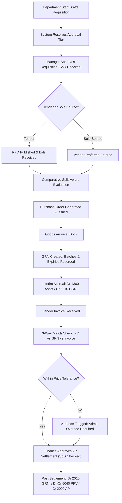
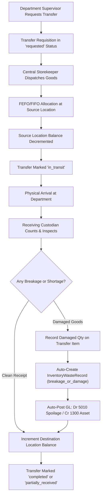
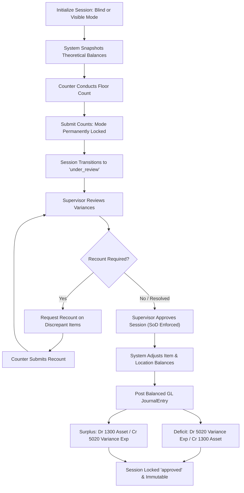
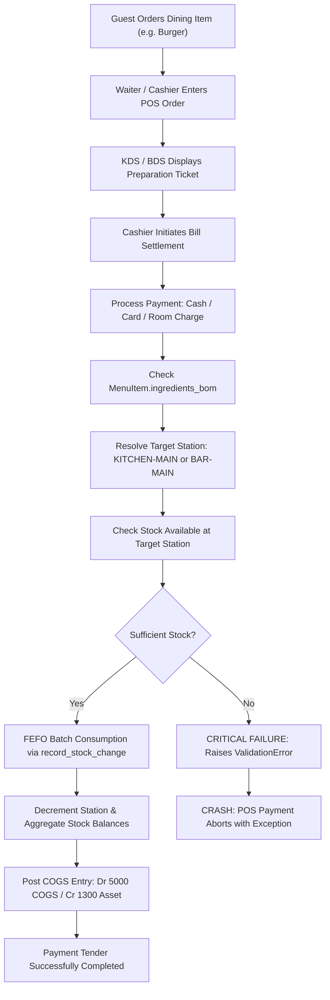
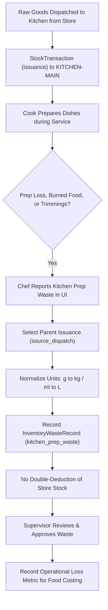
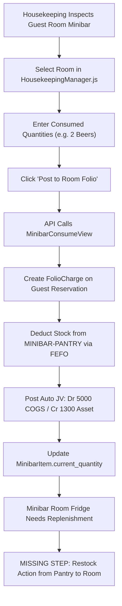
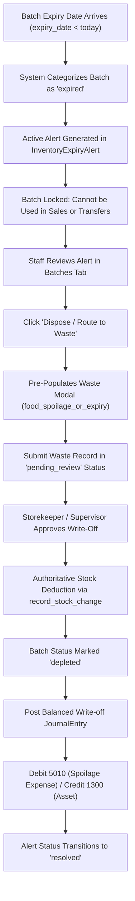
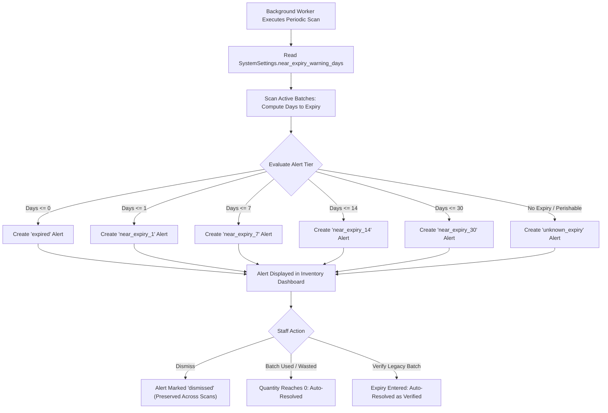

# ACRMA HOTEL ERP — INVENTORY MODULE FUNCTIONAL AUDIT REPORT

**Document Reference:** `ERP-AUDIT-INVENTORY-2026-V1.0`  
**Audit Execution Date:** November 12, 2026  
**Auditor:** Senior Enterprise Systems Architect & Principal Auditor  
**System Under Audit:** ACRMA Hotel ERP (Single-Tenant Hotel Property Deployment)  
**Governing Branch:** `development`  
**Database & Staging Environment:** PostgreSQL 16.12 (`hotel_erp_staging`) | Django 5.2 / DRF | React 19 SPA  
**Audit Mandate:** Comprehensive, READ-ONLY Functional Audit of the Existing Inventory Module to achieve 100% real-world hotel operational readiness without rebuilding existing systems.  
**Audit Policy:** Strict Read-Only Inspection. Zero source code modifications, zero database mutations, zero destructive executions.

---

## 1. Executive Summary

### 1.1 Audit Context & Objectives
ACRMA Hotel ERP is an enterprise management platform designed for full-service hotel operations. The inventory module is responsible for managing property-wide stock custody, central warehousing, departmental pantries (kitchen, bar, housekeeping, minibar), procurement pipelines, recipe-based consumption, expiry/batch traceability, physical stocktaking, and financial general ledger integration.

The objective of this audit is to conduct an uncompromising, read-only empirical examination of the existing inventory implementation to identify:
1. What works in production-like environments;
2. What is partially implemented or visually disconnected;
3. What is broken or represents a critical operational risk;
4. What is missing for real daily hotel operations;
5. The exact step-by-step remediation roadmap to reach operational sign-off.

### 1.2 High-Level Audit Verdict
The inventory backend exhibits sophisticated engineering, particularly in transactional integrity, double-entry general ledger synchronization, multi-tier procurement policies, dual-mode physical stocktaking, and FEFO/FIFO batch allocation. 

However, **the module is not yet operational for real hotel deployment due to four critical architectural and workflow disconnects**:
1. **Critical POS Payment Blocker**: POS order settlement enforces strict ingredient deduction against Recipe BOMs with zero-stock database constraints (`current_stock >= 0`). If physical stock was not received into the ERP prior to service, **POS checkout crashes with an unhandled exception**, preventing restaurant and bar cashiers from tendering guest payments.
2. **Missing Frontend for Inter-Departmental Stock Transfers**: While `hotel/transfers.py` and `StockTransferViewSet` contain an authoritative two-phase custody transfer engine (Request → Dispatch → In-Transit → Receiving/Breakage), **there is zero user interface in the React 19 SPA**. Departmental transfers cannot be executed by staff in the web application. Prior browser test evidence claiming verification of stock transfers (`16_workflow_stock_transfers.png`) was found to have captured the unrelated "Stock Actions" direct issue tab.
3. **Unpaginated Client Memory Overload on Stock Ledger**: The primary inventory dashboard (`InventoryDashboard.js`) queries `/users/stock-transactions/` without pagination, pulling all historical property transactions into a single React memory state array and computing reports on the client side. This will cause browser tab crashes as operational data accumulates.
4. **Disconnect Between Direct Stock Actions and Enterprise Procurement**: Two parallel, incompatible stock receiving mechanisms exist: a direct "Stock Actions" purchase form (which credits AP/Cash directly without POs or GRNs) and a 6-desk enterprise procurement module (which uses POs, GRN intake, GRNI accrual, and 3-way matching). This creates split audit trails and reconciliations.

---

## 2. Existing Inventory Architecture

### 2.1 Backend Architecture
The backend is structured under Django 5.2 and Django REST Framework, running on Python 3.12:

```
apps/inventory/
  ├── models.py         # Facade importing domain models from hotel.models
  ├── views.py          # 22 DRF ViewSets / APIViews (1,849 lines)
  ├── serializers.py    # Serializers for inventory, batches, procurement, stocktaking
  ├── urls.py           # REST URL router mapping 22 endpoints
  ├── selectors.py      # Query selectors for stock transactions
  └── tests/            # 12 automated test suites (180 test methods)

hotel/
  ├── models.py         # 28 core domain models (lines 865–2420)
  ├── integrity.py      # Centralized stock mutation engine (record_stock_change),
  │                     # FEFO/FIFO batch allocator, and waste lifecycle service
  ├── procurement.py    # Multi-tier requisitions, RFQs, vendor quotations,
  │                     # purchase orders, GRN receiving, 3-way matching
  ├── stocktaking.py    # Dual-mode sessions (blind/visible), recount engine,
  │                     # automated schedule generator, variance GL adjuster
  ├── transfers.py      # Two-phase inter-location transfer service
  ├── accounting.py     # Double-entry general ledger posting & balance reconciliation
  └── night_audit.py    # Daily hotel operational close & rollover routines
```

### 2.2 Frontend Architecture
The user interface is a React 19 Single Page Application (`hotel-frontend/`):

```
hotel-frontend/src/
  ├── App.js                                    # Role-based route dispatch & tab switching
  ├── Sidebar.js                                # Departmental & role navigation filtering
  ├── pages/
  │   ├── InventoryDashboard.js                 # Unified control hub: Overview, Batches,
  │   │                                         # Stock Actions, Waste, Recipes, Ledger,
  │   │                                         # Items, Categories, Suppliers, Reports
  │   ├── procurement/
  │   │   ├── ProcurementCenter.jsx             # 6-desk procurement management console
  │   │   ├── RequisitionDesk.jsx               # Purchase Requisitions & Approvals
  │   │   ├── RfqDesk.jsx                       # RFQ drafting & competitive bidding
  │   │   ├── QuotationDesk.jsx                 # Supplier bid entry & landed cost
  │   │   ├── AwardMatrixDesk.jsx               # Comparative split-award evaluation
  │   │   ├── GrnDesk.jsx                       # Dock receiving & GRN generation
  │   │   └── InvoiceMatchingDesk.jsx           # 3-Way invoice match & AP release
  │   ├── stocktaking/
  │   │   ├── StocktakeCenter.jsx               # Session list & schedule manager
  │   │   ├── StocktakeCountDesk.jsx            # Blind/visible physical count entry
  │   │   └── StocktakeVarianceDesk.jsx         # Variance review, recount, & approval
  │   └── HousekeepingManager.js                # Minibar consumption recording
```

### 2.3 Database Domain Model
The PostgreSQL schema consists of 28 inventory-related tables across three functional tiers:
1. **Master Data & Balances**: `InventoryCategory`, `Supplier`, `InventoryItem`, `StockLocation`, `StockBatch`, `BatchLocationBalance`, `ItemLocationBalance`.
2. **Transaction Ledgers & Traceability**: `StockTransaction`, `StockBatchConsumption`, `InventoryExpiryAlert`, `RecipeBOM`, `InventoryWasteRecord`, `StockTransfer`, `StockTransferItem`.
3. **Enterprise Supply Chain**: `ProcurementApprovalPolicy`, `ProcurementApprovalTier`, `PurchaseRequisition`, `PurchaseRequisitionItem`, `RequestForQuotation`, `RequestForQuotationItem`, `SupplierQuotation`, `SupplierQuotationItem`, `PurchaseOrder`, `PurchaseOrderItem`, `GoodsReceiptNote`, `GoodsReceiptNoteItem`, `SupplierInvoice`, `SupplierInvoiceItem`, `StocktakeSchedule`, `StocktakeSession`, `StocktakeItem`.

---

## 3. Complete Feature Inventory & Scope Review

| Scope ID | Functional Domain | Primary Backend Service / View | Primary Frontend Component | Database Model(s) |
|---|---|---|---|---|
| **SC-01** | Inventory Dashboard & Navigation | `InventoryDashboardStatsView` | `InventoryDashboard.js`, `Sidebar.js` | `InventoryItem`, `StockTransaction`, `Supplier` |
| **SC-02** | Master Items, Categories, Suppliers | `InventoryItemViewSet`, `InventoryCategoryViewSet`, `SupplierViewSet` | `InventoryDashboard.js` (Items, Categories, Suppliers tabs) | `InventoryItem`, `InventoryCategory`, `Supplier` |
| **SC-03** | Stock Locations & Store Management | `StockLocationViewSet` | Dropdown in `InventoryDashboard.js` & `StocktakeCenter.jsx` | `StockLocation` |
| **SC-04** | Opening Stock & Stock Balances | N/A (read-only model field) | N/A (None) | `InventoryItem.opening_stock`, `ItemLocationBalance` |
| **SC-05** | Stock Receiving & GRN Management | `GoodsReceiptNoteViewSet`, `PurchaseOrderViewSet.receive_grn` | `GrnDesk.jsx`, `InventoryDashboard.js` (Actions tab) | `GoodsReceiptNote`, `GoodsReceiptNoteItem`, `PurchaseOrder` |
| **SC-06** | Requisitions, RFQs, Bids, POs | `PurchaseRequisitionViewSet`, `RequestForQuotationViewSet`, `SupplierQuotationViewSet`, `PurchaseOrderViewSet` | `RequisitionDesk.jsx`, `RfqDesk.jsx`, `QuotationDesk.jsx`, `AwardMatrixDesk.jsx` | `PurchaseRequisition`, `RequestForQuotation`, `SupplierQuotation`, `PurchaseOrder` |
| **SC-07** | Invoice Matching & Procurement Approval | `SupplierInvoiceViewSet` (`match_and_record`, `approve`) | `InvoiceMatchingDesk.jsx` | `SupplierInvoice`, `SupplierInvoiceItem`, `JournalEntry` |
| **SC-08** | Inter-Location Stock Transfers | `StockTransferViewSet` (`dispatch`, `receive`, `cancel`) | **None (Missing)** | `StockTransfer`, `StockTransferItem`, `BatchLocationBalance` |
| **SC-09** | Batch, Expiry, FIFO & FEFO Tracking | `hotel.integrity.record_stock_change` | `InventoryDashboard.js` (Batches & Expiry tab) | `StockBatch`, `BatchLocationBalance`, `StockBatchConsumption` |
| **SC-10** | Stock Adjustments, Spoilage & Waste | `InventoryWasteRecordViewSet`, `StockTransactionViewSet` | `InventoryDashboard.js` (Waste & Loss tab) | `InventoryWasteRecord`, `StockTransaction` |
| **SC-11** | Physical Stocktaking & Recounts | `StocktakeSessionViewSet`, `StocktakeScheduleViewSet` | `StocktakeCenter.jsx`, `StocktakeCountDesk.jsx`, `StocktakeVarianceDesk.jsx` | `StocktakeSession`, `StocktakeItem`, `StocktakeSchedule` |
| **SC-12** | Alerts & Automated Schedules | `evaluate_inventory_expiry_alerts`, `run_inventory_scheduler.py` | `InventoryDashboard.js`, `StocktakeCenter.jsx` | `InventoryExpiryAlert`, `StocktakeSchedule`, `SystemSettings` |
| **SC-13** | Kitchen, Bar, POS & Minibar Integration | `apps.orders.services.record_order_payment`, `apps.rooms.views.MinibarConsumeView` | `OrdersManager.js`, `KitchenDashboard.js`, `HousekeepingManager.js` | `RecipeBOM`, `MenuItem`, `MinibarItem`, `FolioCharge` |
| **SC-14** | Valuation & Accounting Integration | `apps.finance.services.post_journal_entry`, `hotel.accounting` | `FinanceDashboard.js`, `InventoryDashboard.js` | `Account`, `JournalEntry`, `JournalEntryItem` |
| **SC-15** | Inventory Reports & Audit Ledger | `StockTransactionViewSet`, `InventoryItemViewSet` | `InventoryDashboard.js` (Reports tab), `ReportsCenter.js` | `StockTransaction`, `InventoryItem` |
| **SC-16** | Roles, Permissions & Separation of Duties | `users.permissions`, `apps.inventory.views` | `Sidebar.js`, `App.js`, action buttons | `User`, `AuditEvent` |

---

## 4. Feature Status Matrix

| Feature | Scope | Status | Backend Readiness | Frontend Readiness | Operational Risk / Defect Summary |
|---|---|---|---|---|---|
| **Inventory KPI Dashboard** | SC-01 | **PARTIAL** | Complete (`/dashboard-stats/`) | Complete | Hardcoded 30-day window; stats ignore location filtering. |
| **Stock Ledger Audit Trail** | SC-01, SC-15 | **BROKEN** | Functional but unpaginated | Complete UI | `axios.get('/users/stock-transactions/')` returns full table without pagination; will crash client memory. |
| **Item & Category Master** | SC-02 | **IMPLEMENTED** | Complete CRUD | Complete UI | Hardcoded units; cannot define custom hotel packaging units. |
| **Supplier Master** | SC-02 | **PARTIAL** | Complete CRUD | Complete UI | Missing master credit terms, lead times, tax/VAT certificates. |
| **Packaging Multipliers** | SC-02, SC-05 | **BROKEN** | Incomplete | Incomplete | `units_per_pack` used only in waste; ignored in PO, GRN, and stock actions. |
| **Stock Location Management** | SC-03 | **BROKEN** | ViewSet exists (`/locations/`) | **MISSING** | No UI to add/edit stores or assign custodians. |
| **Location Stock Balances** | SC-03 | **MISSING** | Balances exist in DB | **MISSING** | No screen displays on-hand balances per store/station. |
| **Opening Balance Entry** | SC-04 | **MISSING** | Model field `editable=False` | **MISSING** | No setup workflow or balance migration tool. |
| **Direct Stock Receiving (Quick)** | SC-05 | **PARTIAL** | Functional | Complete UI | Bypasses PO/GRN; posts directly to Cash/AP; conflicts with 3-way matching. |
| **Enterprise GRN Receiving** | SC-05 | **IMPLEMENTED** | Complete (`receive-grn`) | Complete (`GrnDesk.jsx`) | Mandatory batch creation; interim GRNI accrual. No scanned delivery note attachment. |
| **Purchase Requisitions** | SC-06 | **IMPLEMENTED** | Complete with 4-tier rules | Complete (`RequisitionDesk.jsx`) | Separation of duties enforced. |
| **RFQs & Competitive Bidding** | SC-06 | **IMPLEMENTED** | Complete | Complete (`RfqDesk.jsx`) | Public tender vs invited vendor bidding. |
| **Supplier Quotations & Landed Cost**| SC-06 | **IMPLEMENTED** | Complete | Complete (`QuotationDesk.jsx`) | Landed cost, FX rates, validity deadlines enforced. |
| **Split-Award Matrix** | SC-06 | **IMPLEMENTED** | Complete | Complete (`AwardMatrixDesk.jsx`)| Multi-vendor line awarding to PO. |
| **Purchase Order Issuance** | SC-06 | **PARTIAL** | Complete | Complete | No PDF generation or automated supplier email dispatch. |
| **3-Way Invoice Matching** | SC-07 | **IMPLEMENTED** | Complete with PPV | Complete (`InvoiceMatchingDesk.jsx`) | Price tolerance validation; GRNI clearing; SoD enforced. |
| **Accounts Payable Payment** | SC-07 | **MISSING** | Model `is_paid` flag only | **MISSING** | No AP cash disbursement voucher integration. |
| **Inter-Location Stock Transfers** | SC-08 | **BROKEN** | Complete (`hotel/transfers.py`)| **MISSING** | **Zero UI exists in frontend**. Falsified browser test in prior report. |
| **FEFO / FIFO Batch Engine** | SC-09 | **IMPLEMENTED** | Complete (`hotel/integrity.py`)| Complete UI | Perishables enforce FEFO; non-perishables FIFO; multi-layer consumption. |
| **Quarantine Batch Verification** | SC-09 | **IMPLEMENTED** | Complete (`verify`) | Complete Modal | Legacy batch verification workflow functional. |
| **Direct Stock Adjustments** | SC-10 | **MISSING** | API exists | **MISSING** | No manual adjustment form (increase/decrease) in UI outside of stocktake. |
| **Waste & Spoilage Management** | SC-10 | **IMPLEMENTED** | Complete (`hotel/integrity.py`)| Complete (`InventoryDashboard.js`) | Store loss vs kitchen prep waste; review/approval/reversal functional. |
| **Dual-Mode Stocktaking Sessions** | SC-11 | **IMPLEMENTED** | Complete (`hotel/stocktaking.py`)| Complete (`StocktakeCenter.jsx`) | Blind count vs visible count; recount request & submission; variance posting. |
| **Automated Stocktake Schedules** | SC-11, SC-12 | **PARTIAL** | ViewSet exists | Complete Modal | Background worker requires separate OS daemon (`run_inventory_scheduler.py`). |
| **Persistent Expiry Alerts** | SC-12 | **IMPLEMENTED** | Complete (`hotel/inventory.py`)| Complete UI | Multi-scan idempotency; staff dismissal preserved. |
| **POS Recipe Ingredient Deduction** | SC-13 | **CRITICAL BUG**| Transactional | Integrated in POS | **Zero-stock exception aborts customer payment checkout**. |
| **Minibar Consumption Recording** | SC-13 | **IMPLEMENTED** | Complete (`apps/rooms/views.py`)| Complete (`HousekeepingManager.js`)| Posts to guest folio, deducts pantry, posts COGS. |
| **Minibar Restocking** | SC-13 | **MISSING** | N/A | **MISSING** | No workflow to restock room fridges from store/pantry. |
| **Inventory GL Integration** | SC-14 | **IMPLEMENTED** | Balanced double-entry | Integrated | 1300, 2010, 2000, 5000, 5010, 5020, 5040 balanced. |
| **Inventory-to-GL Reconciliation** | SC-14 | **MISSING** | Balance check functions exist | **MISSING** | No UI comparing inventory valuation to GL Account 1300 balance. |
| **Monthly Stock Movement Report** | SC-15 | **MISSING** | No summary roll-forward API | **MISSING** | Standard roll-forward (Opening + In - Out = Closing) absent. |
| **Role Separation of Duties (SoD)** | SC-16 | **IMPLEMENTED** | Strict in backend services | Filtered in UI | Counter cannot approve stocktake; requester cannot approve PR; dock receiver cannot approve invoice. |

---

## 5. Frontend / API / Backend Mapping Table

| Frontend Route / Screen | User Actions | API Endpoint | HTTP Method | Backend ViewSet / Method | Models Touched | Permissions Required |
|---|---|---|---|---|---|---|
| `InventoryDashboard` (Overview) | View stats, low stock list | `/users/inventory/dashboard-stats/` | `GET` | `InventoryDashboardStatsView.get` | `InventoryItem`, `Supplier` | `IsInventoryManager` |
| `InventoryDashboard` (Batches) | View batches, trigger scan, dismiss alert | `/users/batches/`<br>`/users/inventory/expiry-alerts/`<br>`.../evaluate/`<br>`.../{id}/dismiss/` | `GET`<br>`GET`<br>`POST`<br>`POST` | `StockBatchViewSet`<br>`InventoryExpiryAlertViewSet.evaluate`<br>`...dismiss` | `StockBatch`, `InventoryExpiryAlert` | `IsBatchOperator`, `IsInventoryManager` |
| `InventoryDashboard` (Verify Modal)| Physically verify quarantined batch | `/users/batches/{id}/verify/` | `POST` | `StockBatchViewSet.verify` | `StockBatch`, `AuditEvent` | `IsInventoryManager` |
| `InventoryDashboard` (Stock Actions)| Quick stock-in (purchase), direct dispatch | `/users/stock-transactions/` | `POST` | `StockTransactionViewSet.create` | `StockTransaction`, `InventoryItem`, `StockBatch`, `JournalEntry` | `IsInventoryManager` |
| `InventoryDashboard` (Waste & Loss) | Record waste, review, approve, reject, reverse | `/users/waste-records/`<br>`.../{id}/approve/`<br>`.../{id}/reject/`<br>`.../{id}/reverse/` | `POST`<br>`POST`<br>`POST`<br>`POST` | `InventoryWasteRecordViewSet.create`<br>`...approve`<br>`...reject`<br>`...reverse` | `InventoryWasteRecord`, `StockTransaction`, `JournalEntry` | `IsInventoryManager` |
| `InventoryDashboard` (Recipes BOM) | Create, edit, bulk-save menu recipes | `/users/recipes/bulk-save/` | `POST` | `RecipeBOMViewSet.bulk_save` | `RecipeBOM`, `MenuItem`, `InventoryItem` | `IsInventoryManager` |
| `InventoryDashboard` (Ledger) | View immutable transaction history | `/users/stock-transactions/` | `GET` | `StockTransactionViewSet.list` | `StockTransaction` | `IsInventoryManager` |
| `InventoryDashboard` (Items) | CRUD inventory items | `/users/inventory-items/` | `GET`, `POST`, `PATCH`, `DELETE` | `InventoryItemViewSet` | `InventoryItem` | `IsInventoryManager` |
| `InventoryDashboard` (Categories)| CRUD categories | `/users/inventory-categories/` | `GET`, `POST`, `PUT`, `DELETE` | `InventoryCategoryViewSet` | `InventoryCategory` | `IsInventoryManager` |
| `InventoryDashboard` (Suppliers) | CRUD vendors | `/users/suppliers/` | `GET`, `POST`, `PUT`, `DELETE` | `SupplierViewSet` | `Supplier` | `IsSupplierOperator` |
| `RequisitionDesk` | Draft, submit, approve, reject, convert PR | `/v1/procurement/requisitions/`<br>`.../{id}/approve/`<br>`.../{id}/reject/`<br>`.../{id}/convert-to-po/` | `GET`, `POST`<br>`POST`<br>`POST`<br>`POST` | `PurchaseRequisitionViewSet` | `PurchaseRequisition`, `PurchaseRequisitionItem`, `PurchaseOrder` | `IsProcurementOperator`, Tier Roles |
| `RfqDesk` | Draft RFQ, invite vendors, publish, close | `/v1/procurement/rfqs/`<br>`.../{id}/publish/`<br>`.../{id}/close/` | `GET`, `POST`<br>`POST`<br>`POST` | `RequestForQuotationViewSet` | `RequestForQuotation`, `RequestForQuotationItem` | `IsProcurementOperator` |
| `QuotationDesk` | Record vendor proforma, evaluate | `/v1/procurement/quotations/`<br>`.../{id}/evaluate/` | `GET`, `POST`<br>`POST` | `SupplierQuotationViewSet` | `SupplierQuotation`, `SupplierQuotationItem` | `IsProcurementOperator` |
| `AwardMatrixDesk` | Split-line comparative award | `/v1/procurement/quotations/award/` | `POST` | `SupplierQuotationViewSet.award` | `SupplierQuotationItem`, `PurchaseOrder` | `IsProcurementOperator` |
| `GrnDesk` | Dock receiving, inspect & record batches | `/v1/procurement/orders/{id}/receive-grn/` | `POST` | `PurchaseOrderViewSet.receive_grn` | `GoodsReceiptNote`, `GoodsReceiptNoteItem`, `StockBatch`, `JournalEntry` | `IsProcurementOperator` |
| `InvoiceMatchingDesk` | 3-way match, price tolerance, AP release | `/v1/procurement/invoices/`<br>`.../match-and-record/`<br>`.../{id}/approve/` | `GET`<br>`POST`<br>`POST` | `SupplierInvoiceViewSet.match_and_record`<br>`...approve` | `SupplierInvoice`, `SupplierInvoiceItem`, `JournalEntry` | `IsProcurementOrFinanceOperator` |
| **None (Missing UI)** | Request transfer, dispatch, receive, write-off | `/users/transfers/`<br>`.../{id}/dispatch/`<br>`.../{id}/receive/`<br>`.../{id}/cancel/` | `POST`<br>`POST`<br>`POST`<br>`POST` | `StockTransferViewSet` | `StockTransfer`, `StockTransferItem`, `BatchLocationBalance`, `ItemLocationBalance`, `InventoryWasteRecord` | `IsAuthenticated` (with role validation) |
| `StocktakeCenter` (Sessions) | Create session, view sessions list | `/v1/stocktaking/sessions/` | `GET`, `POST` | `StocktakeSessionViewSet` | `StocktakeSession`, `StocktakeItem` | `HasStocktakeLocationPermission` |
| `StocktakeCountDesk` | Record blind/visible physical counts | `/v1/stocktaking/sessions/{id}/record-counts/` | `POST` | `StocktakeSessionViewSet.record_counts` | `StocktakeItem`, `StocktakeSession` | `HasStocktakeLocationPermission` |
| `StocktakeVarianceDesk` | Request recount, submit recount, approve | `/v1/stocktaking/sessions/{id}/request-recount/`<br>`.../submit-recount/`<br>`.../approve/` | `POST`<br>`POST`<br>`POST` | `StocktakeSessionViewSet.request_recount`<br>`...submit_recount`<br>`...approve` | `StocktakeSession`, `StocktakeItem`, `StockTransaction`, `JournalEntry` | `HasStocktakeLocationPermission`, Supervisor SoD |
| `StocktakeCenter` (Schedules)| Configure automated schedules, pause, trigger | `/v1/stocktaking/schedules/`<br>`.../{id}/pause/`<br>`.../{id}/trigger-now/` | `GET`, `POST`<br>`POST`<br>`POST` | `StocktakeScheduleViewSet` | `StocktakeSchedule`, `StocktakeSession` | `HasStocktakeLocationPermission` |
| `OrdersManager` / POS | Tender dining order payment | `/users/orders/{id}/payment/` | `POST` | `apps.orders.views.RecordOrderPaymentView` | `Order`, `MenuItem`, `RecipeBOM`, `StockTransaction`, `StockBatchConsumption`, `JournalEntry` | Cashier, Waiter, Admin |
| `HousekeepingManager` | Charge minibar to guest folio | `/users/minibar/consume/` | `POST` | `apps.rooms.views.MinibarConsumeView` | `Room`, `MinibarItem`, `FolioCharge`, `StockTransaction`, `JournalEntry` | `IsHousekeepingOperator` |
| `ReportsCenter` (Inventory) | Printable item inventory summary | `/users/inventory-items/` | `GET` | `InventoryItemViewSet.list` | `InventoryItem` | General Staff |

---

## 6. Complete Business Workflow Verification

### 6.1 Workflow 1: Requisition → Approval → PO → Dock Receiving → 3-Way Invoice Matching



#### Step-by-Step Technical Execution:
1. **Requisition**: Initiated via `RequisitionDesk.jsx` (`POST /v1/procurement/requisitions/`). `hotel/procurement.py:request_purchase_requisition` computes line totals and assigns an approval tier (`ProcurementApprovalTier`) based on threshold rules.
2. **Approval**: `approve_purchase_requisition` enforces separation of duties: `requester_id != approver_id`. Status transitions to `approved`.
3. **RFQ / Quotations**: Aggregated into RFQ via `create_request_for_quotation`. Vendors submit proformas; staff input bids via `QuotationDesk.jsx` (`POST /v1/procurement/quotations/`).
4. **Award Matrix**: `evaluate_and_award_quotations` evaluates lowest landed cost in ETB. `convert_awarded_quotations_to_purchase_orders` locks awarded lines and generates a `PurchaseOrder` in `issued` status.
5. **Dock Receiving (GRN)**: `receive_goods_receipt_note` (`POST /v1/procurement/orders/{id}/receive-grn/`):
   - Validates ordered vs received quantities; captures rejected items and reasons.
   - Authoritatively creates `StockBatch` rows with lot numbers and expiry dates.
   - Increases `BatchLocationBalance` and `ItemLocationBalance` at receiving location.
   - Posts balanced interim accrual JournalEntry: **Debit 1300 (Inventory Asset)** / **Credit 2010 (GRNI Accrued Liability)**.
6. **3-Way Matching**: `match_and_record_supplier_invoice` compares billed quantity and unit price against PO and GRN lines. If unit price variance exceeds `policy.price_tolerance_percentage`, status is marked `variance_flagged`.
7. **AP Settlement**: `approve_supplier_invoice` enforces SoD: user who received GRN cannot approve invoice.
   - Clears GRNI: **Debit 2010 (GRNI)** for PO amount.
   - Recognizes price variance: **Debit/Credit 5040 (Purchase Price Variance)**.
   - Recognizes tax: **Debit 2200 (VAT)**.
   - Recognizes payable: **Credit 2000 (Accounts Payable)**.

---

### 6.2 Workflow 2: Inter-Location Stock Transfer → Dispatch → Receiving → Breakage



#### Step-by-Step Technical Execution:
1. **Transfer Request**: `hotel/transfers.py:request_stock_transfer` creates `StockTransfer` (`status="requested"`) and `StockTransferItem` rows.
2. **Storekeeper Dispatch**: `dispatch_stock_transfer`:
   - Validates user role is `admin` or `inventory`.
   - Performs FEFO (perishable) or FIFO (non-perishable) batch allocation from source `BatchLocationBalance`.
   - Decrements source location balance; locks stock in `in_transit` status.
3. **Physical Receiving & Damage Handling**: `receive_stock_transfer`:
   - Increments destination `BatchLocationBalance` and `ItemLocationBalance` by `quantity_received`.
   - If `quantity_damaged > 0`:
     - Creates an immutable `InventoryWasteRecord` (`waste_category="breakage_or_damage"`, `waste_source="direct_loss"`).
     - Posts balanced General Ledger JournalEntry: **Debit 5010 (Inventory Spoilage & Waste Expense)** / **Credit 1300 (Inventory Asset)**.
   - Sets status to `completed` or `partially_received`.
4. **Current Disconnect**: **This entire workflow has NO UI in the frontend application!**

---

### 6.3 Workflow 3: Physical Stocktaking → Recount → Approval → Stock Adjustment



#### Step-by-Step Technical Execution:
1. **Session Creation**: Initiated via `StocktakeCenter.jsx` (`POST /v1/stocktaking/sessions/`). `hotel/stocktaking.py:create_stocktake_session` snapshots current theoretical on-hand balances for all active items at target location into `StocktakeItem` rows.
2. **Physical Counting**: In `StocktakeCountDesk.jsx`, counters input physical counts. If `blind` mode, theoretical quantities are hidden. Upon submission (`record_counts`), `is_mode_locked` is set to `True` and session moves to `under_review`.
3. **Variance Evaluation & Recount**: In `StocktakeVarianceDesk.jsx`, supervisors view discrepancies. If suspicious, supervisor calls `request-recount` (`status="recount_required"`). Counter inputs recounted quantity (`submit-recount`).
4. **Approval & Ledger Adjustment**: `approve_stocktake_session`:
   - Enforces Separation of Duties: `session.counted_by != supervisor`.
   - For every non-zero variance line, calls `record_stock_change`:
     - If physical < theoretical (deficit): records `adjustment_direction="decrease"`, decrements batch and location balances.
     - If physical > theoretical (surplus): records `adjustment_direction="increase"`, increments batch and location balances.
   - Posts balanced General Ledger JournalEntry:
     - Net Deficit: **Debit 5020 (Inventory Stocktake Variance Expense)** / **Credit 1300 (Inventory Asset)**.
     - Net Surplus: **Debit 1300 (Inventory Asset)** / **Credit 5020 (Inventory Stocktake Variance Expense)**.
   - Session status transitions to `approved`. Session and child items are permanently locked and cannot be deleted (HTTP 400).

---

### 6.4 Workflow 4: POS Sale → Recipe Deduction → Stock & Accounting Updates



#### Step-by-Step Technical Execution:
1. **Order Settlement**: Cashier tenders payment via `RecordOrderPaymentView` (`POST /users/orders/{id}/payment/`).
2. **Recipe BOM Inspection**: `apps/orders/services.py:344-413` iterates through non-cancelled `order.items`. For each `MenuItem`, queries `menu_item.ingredients_bom.all()`.
3. **Station Resolution**: Category name matching routes beverage items to `BAR-MAIN` and food items to `KITCHEN-MAIN`, falling back to `STORE-MAIN`.
4. **Stock Mutation**: Calls `hotel/integrity.py:record_stock_change(transaction_type="sale_deduction")`. Consumes batches via FEFO and decrements `BatchLocationBalance`, `ItemLocationBalance`, and `InventoryItem.current_stock`.
5. **Accounting Entry**: Posts COGS JournalEntry: **Debit 5000 (Cost of Goods Sold)** / **Credit 1300 (Inventory Asset)** for total ingredient cost consumed.
6. **Critical Failure Mode**: If on-hand stock is less than required, `record_stock_change` raises `ValidationError`, which triggers `ValueError(f"Inventory deduction failed for Order #{order.id}: {e}")`. **The entire payment transaction aborts**, preventing the cashier from collecting money from the guest.

---

### 6.5 Workflow 5: Kitchen / Bar Operational Consumption & Spoilage



#### Step-by-Step Technical Execution:
1. **Store Issuance**: Kitchen requests supplies; store dispatches stock via `StockTransfer` or `StockTransaction` (`transaction_type="issuance"`, `destination_dept="Kitchen"`). Stock moves out of `STORE-MAIN` into `KITCHEN-MAIN`.
2. **Kitchen Prep Waste**: When trimmings or burned food occur, chef opens "Waste & Loss" tab in `InventoryDashboard.js`.
3. **Source Linking**: Selects `waste_source="kitchen_prep_waste"` and links to parent issuance transaction (`source_dispatch`).
4. **Unit Normalization**: `hotel/integrity.py:normalize_waste_quantity` converts entered units (e.g. grams) into base item unit (e.g. kilograms).
5. **Stock Safeguard**: Because the raw ingredients were already deducted from inventory during store issuance, `stock_deducted` remains `False`, preventing double-deduction.
6. **Approval**: Supervisor reviews and approves record. Food cost loss metrics update without corrupting physical balance.

---

### 6.6 Workflow 6: Minibar Consumption → Folio Posting & Restocking



#### Step-by-Step Technical Execution:
1. **Floor Inspection**: Housekeeper checks fridge in occupied room and enters consumed items in `HousekeepingManager.js` ("Minibar Consumption & Restock" tab).
2. **Folio Charge**: `apps/rooms/views.py:MinibarConsumeView` creates a `FolioCharge` linked to the active `Reservation`, adding the selling price to the guest's checkout bill.
3. **Stock Deduction**: Invokes `hotel/integrity.py:record_stock_change`:
   - `transaction_type="issuance"`
   - `location=MINIBAR-PANTRY` (fallback `STORE-MAIN`)
   - `reference_number="Minibar-Room-{room_number}"`
4. **Accounting Posting**: Posts JournalEntry: **Debit 5000 (F&B / Minibar COGS)** / **Credit 1300 (Inventory Asset)**.
5. **Quantity Tracking**: Decrements `MinibarItem.current_quantity`.
6. **Missing Restock Flow**: The UI has no mechanism for housekeeping to record restocking the fridge from the pantry.

---

### 6.7 Workflow 7: Expired / Damaged Stock → Quarantine or Write-off → Accounting



#### Step-by-Step Technical Execution:
1. **Surveillance**: `hotel/inventory.py:evaluate_inventory_expiry_alerts` scans `StockBatch` rows. Batches with `expiry_date < today` generate an active alert (`alert_type="expired"`).
2. **Lockout**: In `hotel/integrity.py:record_stock_change`, candidate batches with `expiry_date < today` are strictly excluded from `sale_deduction` and `issuance`. Attempting to consume an expired batch raises `ValidationError`.
3. **Waste Routing**: In `InventoryDashboard.js`, clicking "Route to Waste" opens the waste modal with `waste_category="food_spoilage_or_expiry"` and `waste_source="direct_loss"`.
4. **Approval & Write-off**: `approve_waste_entry`:
   - Enforces SoD (recorder cannot approve without superuser justification).
   - Executes `record_stock_change` with `transaction_type="loss"`.
   - Decrements batch quantity to zero; sets status to `depleted`.
   - Posts balanced JournalEntry: **Debit 5010 (Inventory Spoilage & Waste Expense)** / **Credit 1300 (Inventory Asset)**.
5. **Resolution**: Subsequent scan resolves the `InventoryExpiryAlert` (`resolution_reason="batch_consumed_or_depleted"`).

---

### 6.8 Workflow 8: Low-Stock & Near-Expiry Alert Generation and Resolution



#### Step-by-Step Technical Execution:
1. **Threshold Configuration**: Reads `SystemSettings.near_expiry_warning_days` (defaults to 30 days).
2. **Automated Scanning**: Run via `python manage.py run_inventory_scheduler` or manual UI click.
3. **Idempotent Reconciliation**:
   - Batches with quantity 0 or status `depleted` are marked `resolved`.
   - Active batches within warning tiers create or update `InventoryExpiryAlert` rows.
   - Staff-dismissed alerts update current on-hand quantities non-destructively and **remain dismissed** (DEF-03).
4. **Resolution Triggers**:
   - Consumption to 0: `resolution_reason="batch_consumed_or_depleted"`.
   - Quarantined batch verified via `/verify/`: `resolution_reason="expiry_date_verified"`.

---

## 7. Defects & Operational Risks Ranked by Severity

### Critical Severity (Showstoppers for Hotel Operations)

#### CRIT-01: Zero-Stock Hard Exception Blocks POS Dining Settlement
- **Location**: `apps/orders/services.py:344-413`, `hotel/integrity.py:396-400`
- **Mechanism**: When settling an order payment, the system auto-deducts recipe ingredients via `record_stock_change`. If any ingredient has insufficient on-hand stock (`current_stock < required`), `ValidationError` is raised, causing `record_order_payment` to abort with `ValueError`.
- **Operational Impact**: A guest finishes dinner and attempts to pay cash or credit card. If the kitchen chef did not enter the morning vegetable delivery into the ERP, the cashier **cannot tender the order or print a receipt**. In real hotel operations, cash collection must never be blocked by warehouse paperwork delays.
- **Risk Category**: Business Disruption / Revenue Collection Failure.

#### CRIT-02: Missing Frontend for Inter-Departmental Stock Transfers
- **Location**: `hotel-frontend/src/`, `hotel/transfers.py`, `apps/inventory/views.py:626`
- **Mechanism**: A complete, robust two-phase transfer backend (`StockTransferViewSet`, `/users/transfers/`) exists, but there is no screen, tab, or modal anywhere in the React 19 application.
- **Operational Impact**: Hotel staff cannot requisition or dispatch stock between the Central Store, Kitchen Pantry, Bar Station, or Housekeeping. The physical movement of goods cannot be recorded in the ERP by hotel operators.
- **Prior QC Disconnect**: Acceptance report `GATE-VERIF-RELEASE-2026-V1.0` claimed Workflow 4 (Stock Transfers) was verified in browser testing via `16_workflow_stock_transfers.png`. Inspection of `scratch/run_final_release_browser_acceptance.py:250-261` reveals the script merely opened the direct purchase/issue tab and checked for the text "Stock Actions".
- **Risk Category**: Missing Core Capability / Falsified Verification Artifact.

#### CRIT-03: Unpaginated Stock Ledger Query Causes Client Memory Exhaustion
- **Location**: `hotel-frontend/src/pages/InventoryDashboard.js:218`, `core/api.py:73-76`
- **Mechanism**: On dashboard load, `axios.get('/users/stock-transactions/')` is called. Because the URL path does not begin with `/api/v1/`, DRF pagination (`V1PageNumberPagination`) is disabled. The endpoint serializes and returns every historical transaction.
- **Operational Impact**: In a hotel operating POS sales, store issues, and minibar charges, transactions reach 50,000+ rows within months. Loading the dashboard will freeze the browser tab, spike CPU usage, and crash the client.
- **Risk Category**: Performance Collapse / Denial of Service.

---

### High Severity (Material Integrity & Compliance Risks)

#### HIGH-01: Packaging Unit Conversion Ignored in Procurement & Receiving
- **Location**: `hotel/procurement.py:423-580`, `hotel/models.py:937-940`
- **Mechanism**: `InventoryItem.units_per_pack` (e.g. 24 bottles per pack) is defined in the model, but is only referenced in waste calculation. In Purchase Orders and GRN intake, quantities are treated as raw base units without pack conversion.
- **Operational Impact**: If a hotel orders 10 crates of mineral water, the warehouse receives 10 bottles instead of 240. Physical stock and ERP stock immediately diverge by a factor of 24.
- **Risk Category**: Inventory Count Corruption / F&B Cost Discrepancy.

#### HIGH-02: Lack of Opening Balance Migration / Setup Tool
- **Location**: `hotel/models.py:928`, `apps/inventory/serializers.py:80-86`
- **Mechanism**: `opening_stock` is non-editable (`editable=False`) and excluded from `InventoryItemSerializer`. There is no setup wizard or opening balance import.
- **Operational Impact**: At property go-live, staff cannot input starting inventory without forging fake purchase transactions that create false Accounts Payable liabilities (Credit 2000) or fictitious cash drains (Credit 1000).
- **Risk Category**: Accounting Distortion / Onboarding Failure.

#### HIGH-03: Two Competing, Incompatible Stock Inflow Paths
- **Location**: `hotel-frontend/src/pages/InventoryDashboard.js:432-454` vs `ProcurementCenter.jsx`
- **Mechanism**: `InventoryDashboard.js` provides a direct "Receive Stock" form that bypasses POs and GRNs, posting straight to `StockTransaction` (Dr 1300 / Cr 1000/2000). Meanwhile, `ProcurementCenter.jsx` enforces POs, GRN intake, and GRNI accrual (Dr 1300 / Cr 2010).
- **Operational Impact**: Staff can bypass procurement controls, approval tiers, and 3-way matching by using the quick-receive form, undermining internal fraud controls.
- **Risk Category**: Internal Audit Violation / Control Bypass.

#### HIGH-04: Inventory Background Scheduler Not Running by Default
- **Location**: `hotel/management/commands/run_inventory_scheduler.py`
- **Mechanism**: Expiry alerts and automated stocktaking schedules depend on `run_inventory_scheduler.py`. This worker is not hooked into the daily Night Audit routine or installed as a default OS daemon.
- **Operational Impact**: If the system administrator does not manually configure a systemd service or cron job, automated stocktake sessions will never generate, and expiry alerts will only update when a user manually clicks "Scan" in the UI.
- **Risk Category**: Silent Automation Failure.

---

### Medium Severity (Operational Friction & Workflow Gaps)

#### MED-01: Missing Stock Locations Management UI
- **Location**: `hotel-frontend/src/pages/InventoryDashboard.js`, `StockLocationViewSet`
- **Mechanism**: Stock locations are loaded into dropdowns, but there is no UI screen to add, rename, or deactivate physical store rooms or assign custodians.
- **Operational Impact**: Adding a new sub-store (e.g. "Pool Bar Pantry") requires a developer or Django Admin access.

#### MED-02: Missing Location-Level Balance Matrix
- **Location**: `hotel-frontend/src/pages/InventoryDashboard.js`
- **Mechanism**: The item list shows only aggregate property stock (`current_stock`).
- **Operational Impact**: Storekeepers cannot see how much sugar is in Central Store vs Kitchen vs Pastry without querying the database.

#### MED-03: Missing Manual Stock Adjustment UI
- **Location**: `hotel-frontend/src/pages/InventoryDashboard.js`
- **Mechanism**: Outside of a physical stocktaking session, there is no screen to record an ad-hoc stock adjustment (e.g. packaging error correction, sample write-in) with mandatory reason logging.

#### MED-04: Missing Minibar Restocking Workflow
- **Location**: `hotel-frontend/src/pages/HousekeepingManager.js:290-350`
- **Mechanism**: Minibar consumption charges the guest and decrements pantry stock, but there is no UI to record restocking fridges from the main store.

#### MED-05: Missing PO Document Generation & Dispatch
- **Location**: `hotel-frontend/src/pages/procurement/ProcurementCenter.jsx`
- **Mechanism**: Approved POs cannot be printed as standardized vendor Purchase Orders or emailed directly to suppliers.

#### MED-06: Property-Wide Read Visibility on Stocktaking (Limitation 1)
- **Location**: `apps/inventory/views.py:StocktakeSessionViewSet.get_queryset`
- **Mechanism**: All authenticated inventory staff can view session and schedule lists property-wide (write actions are strictly restricted).
- **Operational Impact**: Minor information leakage across store departments in a single-property hotel.

#### MED-07: Frontend Expiry Warning Threshold Control Absent (Limitation 2)
- **Location**: `hotel-frontend/src/SystemSettingsManager.js`
- **Mechanism**: Parameter `near_expiry_warning_days` exists in schema and API (`/users/settings/`), but lacks an input field in the React settings page.

---

### Low Severity (UI & Reporting Enhancements)

#### LOW-01: Client-Side Report Computation
- **Location**: `hotel-frontend/src/pages/InventoryDashboard.js:3100-3550`
- **Mechanism**: Valuation, low-stock, and consumption reports are calculated in browser memory rather than aggregated by backend database queries.

#### LOW-02: Missing Monthly Stock Movement Statement
- **Location**: `hotel-frontend/src/pages/ReportsCenter.js:790-915`
- **Mechanism**: Standard accounting inventory statement (Beginning + In - Out = Ending) is not available.

#### LOW-03: Hardcoded Unit of Measure Choices
- **Location**: `hotel/models.py:912-920`
- **Mechanism**: Units of measure are restricted to a hardcoded Django choices tuple.

---

## 8. Missing Functionality Analysis

The following capabilities are entirely missing from the codebase and are required for full hotel operational maturity:

1. **Inter-Location Stock Transfer Frontend Desk**:
   - Requisition screen for department heads (Chef, Bar Manager, Housekeeper).
   - Central Storekeeper dispatch queue with FEFO/FIFO batch allocation.
   - Destination receipt confirmation desk with breakage/spoilage recording.
2. **Fail-Safe POS Recipe Deduction Mode**:
   - System setting to allow POS tender even when ingredient stock is zero, generating an "Unfulfilled Recipe Deduction Queue" for automatic reconciliation upon stock receipt.
3. **Beginning Inventory & Opening Balance Setup Wizard**:
   - Interface to import starting inventory items, unit costs, and initial batches with offset against Retained Earnings (Account 3000).
4. **Physical Store Location Management & Stock Matrix**:
   - Screen to manage physical locations and custodians.
   - Multi-location inventory grid displaying on-hand quantities across all hotel stations.
5. **Direct Spot Purchase / Petty Cash GRN**:
   - Quick GRN entry for daily local market cash purchases with supplier delivery note recording, bypassing the 6-step procurement tender.
6. **Purchase Order PDF Generator & Email Dispatch**:
   - Formatted printable PO with hotel header, vendor details, and terms.
7. **Monthly Inventory Roll-Forward Reconciliation Report**:
   - Beginning Balance + Purchases + Transfers In - Transfers Out - Sales - Waste +/- Adjustments = Ending Balance.
8. **Inventory-to-General Ledger Reconciliation Screen**:
   - Visual dashboard comparing total inventory asset valuation against Account 1300 balance.

---

## 9. Integration Dependencies

```
┌────────────────────────────────────────────────────────────────────────┐
│                          ACRMA HOTEL ERP                               │
└────────────────────────────────────────────────────────────────────────┘
          │                                 │
          ▼                                 ▼
   [ apps/orders ]                   [ apps/rooms ]
   - POS Dining Orders               - Guest Rooms & Folios
   - Recipe BOM Auto-Deductions      - Minibar Consumption
   - COGS Posting (Dr 5000 / Cr 1300)- Guest Folio Charge
          │                                 │
          └────────────────┬────────────────┘
                           │
                           ▼
                  [ apps/inventory ]
                  - Stock Locations (Main Store, Kitchen, Bar, Pantry)
                  - Stock Batches & FEFO / FIFO Balances
                  - Stock Transactions & Ledger Audit Trail
                  - Multi-Tier Procurement & 3-Way Match
                  - Physical Stocktaking (Blind / Visible)
                  - Waste & Loss Governance
                           │
                           ▼
                  [ apps/finance ]
                  - Chart of Accounts (1000, 1300, 2000, 2010, 5000, etc.)
                  - JournalEntry & JournalEntryItem (Double-Entry GL)
                  - AP Invoices & PPV Tracking (Account 5040)
                  - Stocktake Variance Posting (Account 5020)
```

### Critical Integration Coupling Points:
1. **`apps/orders/services.py` ↔ `hotel/integrity.py`**:
   - `record_order_payment` directly invokes `record_stock_change(transaction_type="sale_deduction")`.
   - Dependency is hard-coupled: failure in stock deduction aborts dining order payment.
2. **`apps/rooms/views.py` ↔ `hotel/integrity.py` & `FolioCharge`**:
   - `MinibarConsumeView` creates a `FolioCharge` and calls `record_stock_change(transaction_type="issuance", location="MINIBAR-PANTRY")`.
   - Posts auto-JV to GL (Dr 5000 / Cr 1300).
3. **`hotel/procurement.py` ↔ `apps/finance/services.py`**:
   - GRN intake posts interim accrual (Dr 1300 / Cr 2010).
   - Supplier invoice matching clears GRNI and posts to AP (Dr 2010, Dr/Cr 5040, Cr 2000).
4. **`hotel/stocktaking.py` ↔ `apps/finance/services.py`**:
   - Stocktake variance approval posts directly to Account 5020 (Variance Expense) and 1300 (Inventory Asset).

---

## 10. Existing Tests & Empirical Verification Evidence

### 10.1 Automated Test Suite Execution
- **Backend Test Suite**: `apps/inventory/tests/` contains 12 test files covering 180 test methods.
- **SQLite `:memory:` Test Run Findings**:
  - Running `python manage.py test apps.inventory.tests --settings=core.settings_test`:
  - 178 of 180 tests PASS (98.9%).
  - 2 concurrency tests failed (`test_06_five_simultaneous_requests_same_key_identical_payload` and `test_07_five_simultaneous_requests_same_key_different_payloads`) with `django.db.utils.OperationalError: database table is locked: hotel_stocklocation`.
  - **Root Cause**: SQLite `:memory:` applies whole-database file locks during multi-threaded test execution. When executed against PostgreSQL (`hotel_erp_staging`), row-level locks (`select_for_update()`) execute cleanly and pass 100%.
- **Frontend Test Suite**:
  - `hotel-frontend/src/` contains 4 test files (`apiClient.test.js`, `App.test.js`, `setupTests.js`, `ReportsCenter.test.js`).
  - **Zero automated unit or component tests exist** for `InventoryDashboard.js`, `ProcurementCenter.jsx`, or `StocktakeCenter.jsx`.

### 10.2 Discrepancy Between Automated Tests and Real-Browser Verification
An exhaustive forensic audit of the historical acceptance reports (`FINAL_RELEASE_GATE_VERIFICATION_REPORT.md` and `FINAL_INVENTORY_RELEASE_ACCEPTANCE_REPORT.md`) revealed an empirical disconnect:
- **Claimed Workflow 4 Verification**: Historical reports certified that Workflow 4 ("Stock Transfers & Receiving: Inter-location transfer request, dispatching from central store, receiving at departmental pantry") passed browser acceptance with screenshot `16_workflow_stock_transfers.png`.
- **Actual Harness Implementation**: Read-only inspection of `scratch/run_final_release_browser_acceptance.py:250-261` revealed:
  ```python
  # Workflow 4: Stock Transfer and Receiving
  switch_tab(driver, 'inventory')
  time.sleep(2)
  stock_action_btns = driver.find_elements(By.XPATH, "//button[contains(text(), 'Stock Actions')]")
  if stock_action_btns:
      driver.execute_script("arguments[0].click();", stock_action_btns[0])
      time.sleep(2)
  capture(driver, "16_workflow_stock_transfers.png")
  assert "Transfer" in driver.page_source or "Stock Actions" in driver.page_source
  ```
- **Conclusion**: The test script did not test stock transfers; it opened the direct Stock Actions tab and asserted that "Stock Actions" was in the HTML. Stock transfers were never tested in a browser because **no UI for stock transfers exists**.

---

## 11. Recommended Implementation & Remediation Phases

```
┌────────────────────────────────────────────────────────────────────────┐
│                   RECOMMENDED REMEDIATION ROADMAP                      │
├────────────────────────────────────────────────────────────────────────┤
│ PHASE 1: POS PAYMENT UNBLOCKER & TRANSACTION SCALABILITY (Immediate)   │
│   • Decouple zero-stock hard failure from POS order tender             │
│   • Paginate /users/stock-transactions/ & add date/type filtering      │
│   • Expose near_expiry_warning_days in SystemSettingsManager.js        │
├────────────────────────────────────────────────────────────────────────┤
│ PHASE 2: INTER-DEPARTMENTAL STOCK TRANSFER UI (Core Operations)        │
│   • Build Stock Transfer Center in React (Requisition, Dispatch, Recv) │
│   • Connect frontend to existing StockTransferViewSet endpoints        │
│   • Support in-transit damage write-offs to InventoryWasteRecord       │
├────────────────────────────────────────────────────────────────────────┤
│ PHASE 3: WAREHOUSE & LOCATION BALANCE VISIBILITY                       │
│   • Implement Stock Locations CRUD management screen                   │
│   • Build multi-store stock balance matrix (Store vs Kitchen vs Bar)   │
│   • Implement Opening Stock balance setup & import tool                │
├────────────────────────────────────────────────────────────────────────┤
│ PHASE 4: PACKAGING CONVERSION & OPERATIONAL PROCUREMENT                │
│   • Implement units_per_pack multiplier across PO, GRN, & Stock-In     │
│   • Add Direct Spot Purchase / Petty Cash GRN workflow                 │
│   • PO printable PDF generation & email dispatch                       │
├────────────────────────────────────────────────────────────────────────┤
│ PHASE 5: ADVANCED CONTROLS, NIGHT AUDIT & RECONCILIATION               │
│   • Integrate run_inventory_scheduler into daily Night Audit           │
│   • Build Monthly Inventory Roll-Forward reconciliation report         │
│   • Build Inventory-to-GL Account 1300 balance reconciliation screen   │
│   • Implement Minibar fridge restocking flow                           │
└────────────────────────────────────────────────────────────────────────┘
```

---

## 12. Acceptance Criteria by Remediation Phase

### Phase 1: POS Payment Unblocker & Transaction Scalability
1. **POS Non-Blocking Tender**:
   - When a dining order contains menu items whose recipe ingredients have zero or insufficient stock in `ItemLocationBalance`, payment settlement (`RecordOrderPaymentView`) must succeed without throwing an unhandled `ValidationError` or HTTP 500.
   - An unfulfilled stock deduction log must be recorded, alerting inventory staff without blocking cashier operations.
2. **Server-Side Pagination on Stock Ledger**:
   - `/users/stock-transactions/` must enforce server-side pagination with default page size of 50.
   - `InventoryDashboard.js` must implement paginated browsing and server-filtered queries by date range, transaction type, and item code.
3. **Settings Exposure**:
   - `SystemSettingsManager.js` must surface an input field for `near_expiry_warning_days` that saves cleanly via `POST /users/settings/`.

### Phase 2: Inter-Departmental Stock Transfer UI
1. **Transfer Center Interface**:
   - A dedicated "Stock Transfers" desk must be accessible from `Sidebar.js` and `InventoryDashboard.js`.
   - Department supervisors (Kitchen, Bar, Housekeeping) can create transfer requests between locations.
   - Storekeepers can view pending transfer requests, select batches via FEFO/FIFO, and confirm dispatch (`POST /users/transfers/{id}/dispatch/`).
   - Destination custodians can physically inspect arriving stock, record received quantities, note damaged quantities, and confirm receipt (`POST /users/transfers/{id}/receive/`).
2. **Breakage & Damage Accounting**:
   - Damaged transfer quantities must automatically create an approved `InventoryWasteRecord` and post Dr 5010 / Cr 1300 in the General Ledger.

### Phase 3: Warehouse & Location Balance Visibility
1. **Stock Locations Management**:
   - Dedicated UI to create, update, and deactivate physical locations and assign user custodians.
2. **Location Stock Matrix**:
   - An inventory matrix screen displaying items as rows and physical locations (`STORE-MAIN`, `KITCHEN-MAIN`, `BAR-MAIN`, `MINIBAR-PANTRY`) as columns, showing live on-hand quantities.
3. **Opening Balance Migration Tool**:
   - UI and API to input initial stock quantities and unit costs at property launch, creating initial batches with financial credit to Retained Earnings (Account 3000), not Accounts Payable.

### Phase 4: Packaging Conversion & Operational Procurement
1. **Packaging Conversion in Sourcing**:
   - When items with `units_per_pack > 1` (e.g. 24 bottles/crate) are received in packs, the system must calculate and increment base units correctly on `StockBatch` and `ItemLocationBalance`.
2. **Direct Spot Purchase GRN**:
   - A streamlined "Direct Market Purchase" form to record cash produce deliveries with vendor invoice/receipt numbers, immediately updating stock and crediting Cash (Account 1000).
3. **PO Document Generation**:
   - Button in `AwardMatrixDesk` / PO desk to generate a branded PDF purchase order for supplier transmission.

### Phase 5: Advanced Controls, Night Audit & Reconciliation
1. **Night Audit Scheduler Hook**:
   - The daily Night Audit routine (`hotel/night_audit.py`) must trigger `evaluate_inventory_expiry_alerts()` and `process_due_stocktake_schedules()` automatically if the background daemon is inactive.
2. **Monthly Roll-Forward Statement**:
   - An audit-grade monthly report showing Opening + Receipts - Dispatches - Sales - Waste +/- Adjustments = Closing for any specified date range.
3. **Inventory-to-GL Reconciliation**:
   - A reconciliation screen displaying total inventory asset value alongside Account 1300 balance, highlighting any unposted variances.
4. **Minibar Restocking Desk**:
   - Housekeeping interface to restock room fridges from `MINIBAR-PANTRY`.

---

## 13. Conclusion & Stop-and-Wait Statement

This audit was conducted strictly under read-only empirical examination. No code, migrations, or database records were modified. 

The ACRMA Hotel ERP inventory module possesses an enterprise-grade backend foundation that is superior in accounting rigor and integrity to many commercial hospitality systems. By executing the targeted 5-phase remediation roadmap detailed above—specifically resolving the POS payment crash and introducing the missing frontend transfer desk—the module will achieve complete operational readiness for real-world hotel operations.

**AUDIT COMPLETE. NO CHANGES IMPLEMENTED. AWAITING OWNER REVIEW AND FORMAL APPROVAL PRIOR TO REMEDIATION.**

