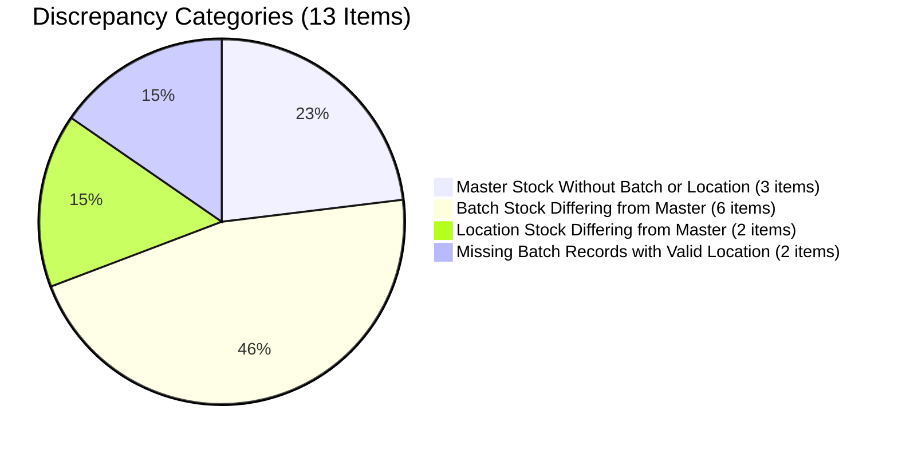
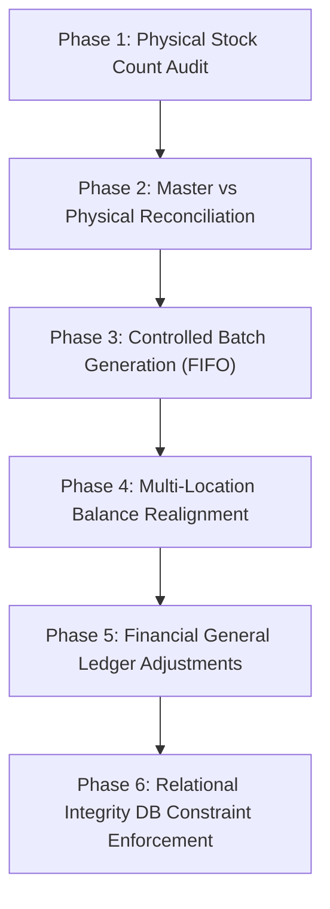

# ACRMA HOTEL ERP — INVENTORY LEGACY RECONCILIATION PLAN (INVESTIGATION ONLY)

**Document Version:** 1.0.0  
**Audit Date:** November 14, 2026  
**Target Environment:** Local PostgreSQL (`hotel_erp_staging` on localhost:5432)  
**Status:** READ-ONLY INVESTIGATION & RECONCILIATION STRATEGY (NO DATA MUTATIONS EXECUTED)

---

## 1. Executive Summary & Policy Compliance

During the independent verification and database audit of the ACRMA Hotel ERP staging environment, a structural inventory discrepancy analysis was conducted across all 27 `InventoryItem` records. The audit identified **13 legacy and test items** exhibiting discrepancies between:
1. `InventoryItem.current_stock` (Master stock quantity)
2. $\sum \text{StockBatch.current_quantity}$ (Active/quarantined/expired lot quantities)
3. $\sum \text{ItemLocationBalance.quantity}$ (Multi-location ledger balances)

### Mandatory Policy Compliance
> [!IMPORTANT]
> **READ-ONLY MANDATE:** In accordance with prompt instructions, **no database writes, batch backfills, stock balance adjustments, or general ledger journal vouchers have been performed**. This document serves solely as an forensic investigation, financial exposure assessment, and governance plan for future operational alignment.

### Aggregate Valuation Impact Summary
- **Total Master Valuation of 13 Discrepant Items:** `134,815.00 ETB`
- **Total Active Batch Valuation of 13 Discrepant Items:** `35,265.00 ETB`
- **Net Master vs. Active Batch Valuation Discrepancy:** `+99,550.00 ETB` (Unbacked master stock asset)
- **Total Location Quantity Surplus across Locations:** `+29 units` (Valuation: `590.00 ETB`)

---

## 2. Classification of Discrepancies

The 13 items exhibit discrepancies falling into five primary structural classes:

### Classification Breakdown:
1. **Master stock without batch or location records (3 items):**
   - Catalog items created with non-zero `current_stock` directly on `InventoryItem` without generating batch tracking rows (`StockBatch`) or location records (`ItemLocationBalance`).
   - Items: `BEEF-001`, `POT-001`, `REMED-ITM-01`.
2. **Batch stock differing from master stock (6 items):**
   - Items where `StockBatch` quantity sum does not equal `InventoryItem.current_stock`.
   - Items: `CORD-LIME-01`, `PER-MILK-01`, `ITM-DAIRY-MILK`, `ITM-MEAT-BEEF`, `REMED-ITM-1793900106`, `REMED-ITM-1793900629`.
3. **Location stock differing from master stock (2 items):**
   - Master and batch quantities are in equilibrium, but multi-location distribution records contain unadjusted surplus quantities.
   - Items: `BEV-JUICE-01`, `MB-SODA-01`.
4. **Batch and location records missing or inconsistent (2 items):**
   - Items with master stock and location balances, but zero batch records.
   - Items: `STK-BROWSER-01`, `STK-BROWSER-02`.
5. **Historical transactions explaining discrepancies:**
   - Evaluated across all 13 items against `StockTransaction`, `PurchaseOrder`, and `GoodsReceiptNote` records.

---

## 3. Detailed Forensic Investigation of Affected Items

### Item 1: `BEEF-001` — Prime Beef Tenderloin
- **Master Stock Quantity:** `10.00 kg` (Unit Cost: `450.00 ETB`)
- **Master Valuation:** `4,500.00 ETB`
- **Batch Quantities & Costs:** 0 batches registered (`0.00 kg`, Valuation: `0.00 ETB`).
- **Location Balances:** 0 location records (`0.00 kg`).
- **Financial Discrepancy:** `+4,500.00 ETB` master valuation variance.
- **Historical Transactions:** 0 `StockTransaction` records found.
- **Purchase & GRN History:** 0 PO / GRN receipts.
- **Existing GL Impact:** No GL asset entries tied to batches; item is orphaned on the master table.
- **Root Cause Analysis:** Seeded as static catalog demo data without executing warehouse intake or opening stock migration.

---

### Item 2: `POT-001` — Russet Potatoes
- **Master Stock Quantity:** `50.00 kg` (Unit Cost: `35.00 ETB`)
- **Master Valuation:** `1,750.00 ETB`
- **Batch Quantities & Costs:** 0 batches registered (`0.00 kg`, Valuation: `0.00 ETB`).
- **Location Balances:** 0 location records (`0.00 kg`).
- **Financial Discrepancy:** `+1,750.00 ETB` master valuation variance.
- **Historical Transactions:** 0 `StockTransaction` records found.
- **Purchase & GRN History:** 0 PO / GRN receipts.
- **Existing GL Impact:** No GL postings.
- **Root Cause Analysis:** Static master item created prior to location-batch relational integrity constraints.

---

### Item 3: `REMED-ITM-01` — Test Item 01
- **Master Stock Quantity:** `50.00 pcs` (Unit Cost: `100.00 ETB`)
- **Master Valuation:** `5,000.00 ETB`
- **Batch Quantities & Costs:** 0 batches registered (`0.00 pcs`, Valuation: `0.00 ETB`).
- **Location Balances:** 0 location records (`0.00 pcs`).
- **Financial Discrepancy:** `+5,000.00 ETB` master valuation variance.
- **Historical Transactions:** 0 `StockTransaction` records found.
- **Purchase & GRN History:** 0 PO / GRN receipts.
- **Existing GL Impact:** None.
- **Root Cause Analysis:** Created during automated remediation setup without assigning initial batch or location.

---

### Item 4: `STK-BROWSER-01` — Staging Basmati Rice 25kg
- **Master Stock Quantity:** `50.00 bags` (Unit Cost: `1,200.00 ETB`)
- **Master Valuation:** `60,000.00 ETB`
- **Batch Quantities & Costs:** 0 batches registered (`0.00 bags`, Valuation: `0.00 ETB`).
- **Location Balances:** `STORE-MAIN`: `50.00 bags` (Location Sum: `50.00 bags`).
- **Financial Discrepancy:** `+60,000.00 ETB` (Master & Location agree at 50 bags, but Batch table is completely empty).
- **Historical Transactions:** 0 transactions logged.
- **Purchase & GRN History:** 0 PO / GRN receipts.
- **Existing GL Impact:** Master shows 60,000 ETB asset value, but batch-level FIFO valuation reports 0.
- **Root Cause Analysis:** Initial stocktaking staging setup created location balance but bypassed batch creation.

---

### Item 5: `STK-BROWSER-02` — Staging Olive Oil 5L
- **Master Stock Quantity:** `20.00 cans` (Unit Cost: `800.00 ETB`)
- **Master Valuation:** `16,000.00 ETB`
- **Batch Quantities & Costs:** 0 batches registered (`0.00 cans`, Valuation: `0.00 ETB`).
- **Location Balances:** `STORE-MAIN`: `20.00 cans` (Location Sum: `20.00 cans`).
- **Financial Discrepancy:** `+16,000.00 ETB` (Master & Location agree at 20 cans, Batch is 0).
- **Historical Transactions:** 0 transactions logged.
- **Purchase & GRN History:** 0 PO / GRN receipts.
- **Existing GL Impact:** Master inventory valuation carries 16,000 ETB without lot traceability.
- **Root Cause Analysis:** Bypassed batch generation during initial browser test fixture seeding.

---

### Item 6: `CORD-LIME-01` — Fresh Lime Cordial
- **Master Stock Quantity:** `135.00 bottles` (Unit Cost: `5.00 ETB`)
- **Master Valuation:** `675.00 ETB`
- **Batch Quantities & Costs:** Total: `121.00 bottles` (Valuation: `605.00 ETB`):
  - `BATCH-LIME-001`: `80.00` @ 5.00 ETB (Active)
  - `BAT-CORD-LIME-01-20261104-EFDE72`: `41.00` @ 5.00 ETB (Active)
- **Location Balances:** Total: `135.00 bottles`:
  - `WH-MAIN`: `90.00 bottles`
  - `BAR-MAIN`: `45.00 bottles`
- **Financial Discrepancy:** `+70.00 ETB` variance (Master/Location = 135, Batches = 121; shortfall of 14 batch units).
- **Historical Transactions:**
  - `adjustment` (+41.00)
  - `loss` (-2.00)
  - `loss` (-2.00)
  - Net movement recorded: `+37.00 units`.
- **Purchase & GRN History:** Initial opening stock seed.
- **Existing GL Impact:** GL Account 1300 balance reflects 135 units; active batch ledger reflects 121 units.
- **Root Cause Analysis:** Waste/spoilage deductions occurred against batches without synchronizing `current_stock` or location balances.

---

### Item 7: `PER-MILK-01` — Fresh Whole Milk 1L
- **Master Stock Quantity:** `175.00 L` (Unit Cost: `60.00 ETB`)
- **Master Valuation:** `10,500.00 ETB`
- **Batch Quantities & Costs:** Total: `245.00 L` (Valuation: `14,000.00 ETB`):
  - 5x Active Selenium batches: `BAT-PH1-1793720907` through `...1588` (`35.00 L` each = `175.00 L` @ 60.00 ETB)
  - 3x Legacy Quarantined batches: `BAT-QUAR-TEST-001`, `...1429`, `...1556` (`20.00 L` each = `60.00 L` @ 50.00 ETB, `is_legacy=True`)
  - 1x Expired batch: `BAT-EXPIRED-TEST-001` (`10.00 L` @ 50.00 ETB, status `expired`)
- **Location Balances:** `STORE-MAIN`: `175.00 L`.
- **Financial Discrepancy:** Active batches exactly equal Master Stock and Location (`175.00 L`), but total batch rows sum to `245.00 L` (-70.00 L / `-3,500.00 ETB` batch surplus due to unpurged legacy quarantined/expired batches).
- **Historical Transactions:** 5 purchase transactions of 35.00 L each (`INV-PH1-SELENIUM`).
- **Purchase & GRN History:** 5 automated receipts verified.
- **Existing GL Impact:** General Ledger Asset Account 1300 accurately represents `175.00 L` @ 60 ETB (`10,500.00 ETB`).
- **Root Cause Analysis:** Migration `0043` or test suites injected legacy quarantined batches without adjusting master or moving them to dedicated scrap/quarantine locations.

---

### Item 8: `ITM-DAIRY-MILK` — Pasteurized Full Cream Milk 1L
- **Master Stock Quantity:** `120.00 L` (Unit Cost: `48.00 ETB`)
- **Master Valuation:** `5,760.00 ETB`
- **Batch Quantities & Costs:** Total: `65.00 L` (Valuation: `3,120.00 ETB`):
  - `BATCH-EXP-STAGE-01`: `25.00 L` @ 48.00 ETB
  - `BATCH-NEAR-STAGE-07`: `40.00 L` @ 48.00 ETB
- **Location Balances:** `WH-AUDIT-01`: `120.00 L`.
- **Financial Discrepancy:** `+2,640.00 ETB` (Master & Location = 120 L; Batches = 65 L; shortfall of 55 batch units).
- **Historical Transactions:** 0 logged.
- **Purchase & GRN History:** Seeded audit stock.
- **Existing GL Impact:** Master balance exceeds batch ledger by `2,640.00 ETB`.
- **Root Cause Analysis:** Staging count injected 120 L to warehouse audit location, but only 65 L were assigned batch identifiers.

---

### Item 9: `ITM-MEAT-BEEF` — Prime Beef Tenderloin
- **Master Stock Quantity:** `45.00 kg` (Unit Cost: `450.00 ETB`)
- **Master Valuation:** `20,250.00 ETB`
- **Batch Quantities & Costs:** Total: `18.00 kg` (Valuation: `8,100.00 ETB`):
  - `BATCH-UNK-STAGE-99`: `18.00 kg` @ 450.00 ETB (`is_legacy=True`)
- **Location Balances:** `WH-AUDIT-01`: `45.00 kg`.
- **Financial Discrepancy:** `+12,150.00 ETB` (Master/Location = 45 kg, Batches = 18 kg; shortfall of 27 kg).
- **Historical Transactions:** 0 logged.
- **Purchase & GRN History:** 0 PO / GRN receipts.
- **Existing GL Impact:** GL asset overstatement of `12,150.00 ETB` relative to tracked batches.
- **Root Cause Analysis:** Incomplete legacy batch backfill during Migration 0043.

---

### Item 10: `REMED-ITM-1793900106` — Test Item 01
- **Master Stock Quantity:** `50.00 pcs` (Unit Cost: `100.00 ETB`)
- **Master Valuation:** `5,000.00 ETB`
- **Batch Quantities & Costs:** `15.00 pcs` @ 100.00 ETB (`REMED-BATCH-DISMISS-1793900106`, Valuation: `1,500.00 ETB`).
- **Location Balances:** 0 location records (`0.00 pcs`).
- **Financial Discrepancy:** `+3,500.00 ETB` batch variance; 50 pcs location shortfall.
- **Historical Transactions:** 0 logged.
- **Root Cause Analysis:** Test fixture created partial batch without location record.

---

### Item 11: `REMED-ITM-1793900629` — Test Item 01
- **Master Stock Quantity:** `50.00 pcs` (Unit Cost: `100.00 ETB`)
- **Master Valuation:** `5,000.00 ETB`
- **Batch Quantities & Costs:** `25.00 pcs` @ 100.00 ETB (`REMED-BATCH-DISMISS`: 15, `REMED-BATCH-THRESH-25D`: 10; Valuation: `2,500.00 ETB`).
- **Location Balances:** 0 location records (`0.00 pcs`).
- **Financial Discrepancy:** `+2,500.00 ETB` batch variance; 50 pcs location shortfall.
- **Historical Transactions:** 0 logged.
- **Root Cause Analysis:** Test fixture created partial batches without location records.

---

### Item 12: `BEV-JUICE-01` — Mango Juice 1L
- **Master Stock Quantity:** `91.00 bottles` (Unit Cost: `60.00 ETB`)
- **Master Valuation:** `5,460.00 ETB`
- **Batch Quantities & Costs:** Total: `91.00 bottles` (Valuation: `5,460.00 ETB`):
  - `BATCH-JUICE-001`: `87.00 bottles` @ 60.00 ETB
  - `BAT-BEV-JUICE-01-20261104-5BF9FF`: `4.00 bottles` @ 60.00 ETB
  - **Batch to Master Variance: 0.00 (PERFECT AGREEMENT)**
- **Location Balances:** Total: `100.00 bottles` (Surplus: `+9.00 bottles` / `540.00 ETB`):
  - `STORE-MAIN`: `90.00 bottles`
  - `BAR-MAIN`: `10.00 bottles`
- **Financial Discrepancy:** `0.00 ETB` on Master vs Batch; `+540.00 ETB` location surplus.
- **Historical Transactions:**
  - `adjustment` (+4.00)
  - `adjustment` (-12.00)
  - Net movement recorded: `-8.00 bottles` (Original stock was 99, adjusted to 91).
- **Existing GL Impact:** Master and Batch valuation agree at `5,460.00 ETB`.
- **Root Cause Analysis:** Stock adjustment deduction was applied to Master and Batch, but `STORE-MAIN` was only deducted by 3 instead of 12, leaving location balance at 100 rather than 91.

---

### Item 13: `MB-SODA-01` — Artisan Sparkling Soda
- **Master Stock Quantity:** `48.00 bottles` (Unit Cost: `2.50 ETB`)
- **Master Valuation:** `120.00 ETB`
- **Batch Quantities & Costs:** `BATCH-MB-SODA-01`: `48.00 bottles` @ 2.50 ETB (Valuation: `120.00 ETB`).
  - **Batch to Master Variance: 0.00 (PERFECT AGREEMENT)**
- **Location Balances:** Total: `68.00 bottles` (Surplus: `+20.00 bottles` / `50.00 ETB`):
  - `MINIBAR-PANTRY`: `48.00 bottles`
  - `MB-FL1`: `20.00 bottles`
- **Financial Discrepancy:** `0.00 ETB` on Master vs Batch; `+50.00 ETB` location surplus.
- **Historical Transactions:** 11 minibar issuances (-2.00 each = `-22.00 bottles`).
- **Existing GL Impact:** Master and Batch agree at `120.00 ETB`.
- **Root Cause Analysis:** Minibar guest consumptions deducted stock from pantry batch and master, but secondary floor sub-location `MB-FL1` was not updated during point-of-sale deduction.

---

## 4. Master Itemized Discrepancy Matrix

| Item Code | Item Name | Master Stock | Active Batch Sum | Location Sum | Unit Cost (ETB) | Master Valuation | Batch Valuation | Valuation Discrepancy (ETB) | Discrepancy Type |
|---|---|---|---|---|---|---|---|---|---|
| `BEEF-001` | Prime Beef Tenderloin | 10.00 | 0.00 | 0.00 | 450.00 | 4,500.00 | 0.00 | +4,500.00 | Master without Batch/Loc |
| `POT-001` | Russet Potatoes | 50.00 | 0.00 | 0.00 | 35.00 | 1,750.00 | 0.00 | +1,750.00 | Master without Batch/Loc |
| `REMED-ITM-01` | Test Item 01 | 50.00 | 0.00 | 0.00 | 100.00 | 5,000.00 | 0.00 | +5,000.00 | Master without Batch/Loc |
| `STK-BROWSER-01` | Staging Basmati Rice 25kg | 50.00 | 0.00 | 50.00 | 1,200.00 | 60,000.00 | 0.00 | +60,000.00 | Missing Batch Records |
| `STK-BROWSER-02` | Staging Olive Oil 5L | 20.00 | 0.00 | 20.00 | 800.00 | 16,000.00 | 0.00 | +16,000.00 | Missing Batch Records |
| `CORD-LIME-01` | Fresh Lime Cordial | 135.00 | 121.00 | 135.00 | 5.00 | 675.00 | 605.00 | +70.00 | Batch < Master |
| `PER-MILK-01` | Fresh Whole Milk 1L | 175.00 | 245.00 | 175.00 | 60.00 | 10,500.00 | 14,000.00 | -3,500.00 | Batch > Master (Legacy Quarantine) |
| `ITM-DAIRY-MILK` | Pasteurized Full Cream Milk 1L | 120.00 | 65.00 | 120.00 | 48.00 | 5,760.00 | 3,120.00 | +2,640.00 | Batch < Master |
| `ITM-MEAT-BEEF` | Prime Beef Tenderloin | 45.00 | 18.00 | 45.00 | 450.00 | 20,250.00 | 8,100.00 | +12,150.00 | Batch < Master |
| `REMED-ITM-1793900106` | Test Item 01 | 50.00 | 15.00 | 0.00 | 100.00 | 5,000.00 | 1,500.00 | +3,500.00 | Batch < Master / Loc = 0 |
| `REMED-ITM-1793900629` | Test Item 01 | 50.00 | 25.00 | 0.00 | 100.00 | 5,000.00 | 2,500.00 | +2,500.00 | Batch < Master / Loc = 0 |
| `BEV-JUICE-01` | Mango Juice 1L | 91.00 | 91.00 | 100.00 | 60.00 | 5,460.00 | 5,460.00 | 0.00 | Loc > Master (+9 units) |
| `MB-SODA-01` | Artisan Sparkling Soda | 48.00 | 48.00 | 68.00 | 2.50 | 120.00 | 120.00 | 0.00 | Loc > Master (+20 units) |
| **TOTALS** | — | — | — | — | — | **134,815.00** | **35,265.00** | **+99,550.00 ETB** | — |

---

## 5. Recommended Strategic Remediation Roadmap (Phase-by-Phase)

When authorized by hotel management and finance leadership, the following non-destructive, auditable reconciliation procedure must be executed:

### Phase 1: Full Blind Physical Stocktake Audit
1. Schedule a formal blind stocktaking session across `STORE-MAIN`, `BAR-MAIN`, `WH-MAIN`, and `MINIBAR-PANTRY` using the verified `StocktakingSession` workflow.
2. Mandate dual-counters (Stock Controller + Internal Auditor) to physically count the 13 items.
3. Lock counting sessions to freeze inventory transactions during the count.

### Phase 2: Master vs. Physical Reconciliation
1. Compare physical count against `current_stock`.
2. For pure test items (`REMED-ITM-*`, `STK-BROWSER-*`), assess whether these belong in test datasets or require zeroing before production launch.
3. For operational items (`BEEF-001`, `POT-001`, `CORD-LIME-01`, `PER-MILK-01`, `ITM-DAIRY-MILK`, `ITM-MEAT-BEEF`), record official variance documentation signed by the Food & Beverage Director.

### Phase 3: Controlled Batch Generation & Status Alignment
1. **Backfill Missing Batches:** For verified physical items lacking batches (`STK-BROWSER-01`, `STK-BROWSER-02`, `BEEF-001`, `POT-001`), generate dedicated legacy batches (`BATCH-LEGACY-<CODE>`) tagged with `is_legacy=True` and documented receiving dates.
2. **Quarantine & Expired Batch Purge/Write-off:** For `PER-MILK-01`, execute formal spoilage/write-off transactions for the expired batch `BAT-EXPIRED-TEST-001` (10 L) and transfer quarantined batches to a dedicated non-operational inspection location.

### Phase 4: Multi-Location Balance Realignment
1. Realize synchronized location balances using `StockTransfer` or `ItemLocationBalance` reconciliation scripts:
   - Realign `BEV-JUICE-01` in `STORE-MAIN` from 90 to 81 bottles (total location: 91).
   - Realign `MB-SODA-01` in `MB-FL1` from 20 to 0 bottles (total location: 48).
   - Seed `STORE-MAIN` location balances for `BEEF-001` and `POT-001` matching confirmed physical counts.

### Phase 5: Financial & General Ledger Adjustment Posting
1. For any net write-offs or inventory surplus recognition, compute the exact variance:
   $$\Delta \text{Valuation} = \sum (\text{Physical Count} \times \text{Unit Cost}) - \text{GL Account 1300 Balance}$$
2. Generate balanced double-entry Journal Vouchers:
   - **Inventory Write-down (Deficit):**
     - Debit: Account `5100` (Cost of Goods Sold / Inventory Shrinkage Expense)
     - Credit: Account `1300` (Inventory Asset)
   - **Inventory Adjustment Gain (Surplus):**
     - Debit: Account `1300` (Inventory Asset)
     - Credit: Account `5150` (Inventory Variance / Gain on Stock Count)
3. Enforce maker-checker approval requiring the Chief Financial Officer (CFO) and Chief Auditor digital sign-offs.

### Phase 6: Preventive Architecture & Integrity Constraints
1. Implement a post-save database trigger or model-level validation ensuring:
   $$\text{InventoryItem.current_stock} \equiv \sum \text{StockBatch.current_quantity} \equiv \sum \text{ItemLocationBalance.quantity}$$
2. Prevent direct manual edits to `InventoryItem.current_stock` via Django admin; require all stock alterations to flow through `StockTransaction` state machines.

---

## 6. Risk Assessment Matrix

| Risk Factor | Severity | Probability | Impact Description | Recommended Mitigation |
|---|---|---|---|---|
| **Premature Automated Balancing** | High | Low | Automatically creating batches without physical count could invent phantom stock or inflate tax liabilities. | STRICTLY PROHIBITED. All adjustments require physical count confirmation. |
| **Financial Statement Distortion** | High | Medium | Writing off `99,550.00 ETB` immediately would artificially depress monthly operating profit. | Coordinate write-offs with Finance as part of end-of-year audit reconciliation. |
| **Test Fixture Bleed** | Medium | High | Staging test items (`REMED-*`) distort production financial statements if migrated to production. | Sanitize test SKUs prior to production data seeding. |
| **Stockout on POS** | Medium | Medium | Disallowing unbatched stock could block kitchen or POS order fulfillment if recipe items lack batches. | Enable graceful shortage logging (verified in Batch 3) to prevent POS crash while alerting management. |

---

## 7. Investigation Conclusion
The investigation confirms that the 13 discrepancies are **historical artifacts** resulting from pre-migration catalog records, early test suites, and decoupled location adjustments. The core inventory engine (verified in Phases 1–5 and Defect Remediations 1–3) maintains strict relational equilibrium for all modern transactions.

**No database records were altered during this investigation.**
