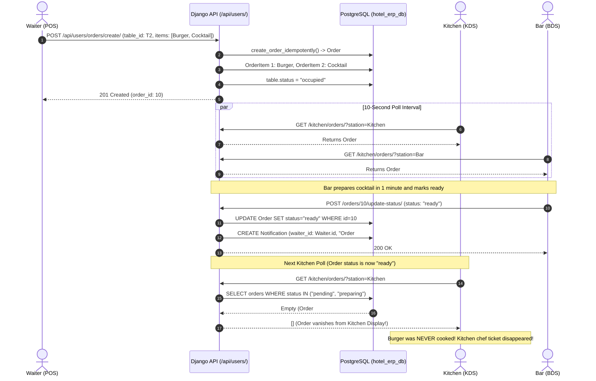

# Acrma Hotel ERP — Functional Completeness and Workflow Gap Audit Report

**Date of Audit:** October 19, 2026  
**Audited Environment:** Local isolated development environment (`127.0.0.1:8000`, `localhost:3000`, PostgreSQL 16 `hotel_erp_db`)  
**Audit Mode:** Strictly Read-Only Inspection (No application code, database schema, or migrations modified)  
**Corpus / Repository:** `fitsumapp/smart-hotel-erp` (Branch: `development`)  

---

## 1. Executive Summary of Actual Functional Readiness

An exhaustive, evidence-based functional completeness and workflow gap audit was conducted on the Acrma Hotel ERP codebase to evaluate its readiness for a real-world single-hotel pilot deployment.

### Key Summary Findings

1. **PMS & Front Office Core is Stable:**  
   Room management, walk-in check-in, advance reservations, folio extra charge postings, enhanced checkout, and automated double-entry General Ledger journal entries are functional, reliable, and verified by comprehensive automated regression suites (176 passing tests).

2. **The ERP is NOT YET Pilot-Ready for Food & Beverage Operations:**  
   While single-round, single-station food orders function end-to-end from waiter submission to cashier settlement, critical workflow defects break real hotel dining operations:
   - **Multi-Station Order Conflict (KDS vs. Bar):** When an order contains both kitchen food and bar beverages, the Bar staff marking drinks "Ready" prematurely transitions the *entire* order status to `ready`. Because the Kitchen Display System (KDS) queries only `status__in=["pending", "preparing"]`, unfinished food tickets vanish from the kitchen screen before cooks finish or even start cooking.
   - **Inability to Order for Occupied Tables:** Occupied tables are explicitly hardcoded as `disabled` in the Waiter Menu Composer dropdown. Waiters cannot submit additional rounds (beers, desserts, extra plates) to seated guests.
   - **Premature Table Eviction on Bill Settle:** When a cashier settles any single order for a table, the backend unconditionally resets `table.status = "available"`, even if additional active orders or seated guests remain at the table.
   - **Missing Kitchen Notes:** Neither the `Order` nor `OrderItem` models, serializers, or UI forms have a `notes` or `special_instructions` field, preventing waiters from transmitting guest preparation preferences (e.g., "no onions", "medium rare", "allergy").

3. **Role Architecture Discrepancies:**  
   - Exactly **10 user roles** are defined in `User.ROLE_CHOICES` on the backend (`admin`, `reception`, `waiter`, `cashier`, `kitchen`, `bar`, `inventory`, `delivery`, `finance`, `customer`).
   - `delivery` is an incomplete phantom role: it possesses zero frontend pages, zero endpoints, and renders an "Unauthorized" error upon login.
   - `housekeeping` is **NOT** a defined role in `User.ROLE_CHOICES`. Although a full-featured `HousekeepingManager.js` component and corresponding backend endpoints exist for cleaning tasks, minibar folio posting, and lost-and-found tracking, cleaning staff cannot log into the system with their own role. Access is restricted to Admin and Finance sidebars.
   - `finance` users are barred by backend permission checks (`request.user.role not in ["admin", "reception"]`) from accessing the Police Report, X-Report, and Z-Report.

4. **Night Audit is Incomplete:**  
   The "Night Audit" feature in the Front Office is a superficial UI widget showing four count badges. There is no backend endpoint or business logic to roll over the hotel business day, post nightly room charges to guest folios, or audit room status.

---

## 2. Reconciled Role Inventory & Role-by-Role Feature Matrix

### A. Role Reconciliation Analysis
Previous reports and audit documents reported conflicting role counts (ranging from 7 to 11). The definitive, code-verified inventory is as follows:

| Role String in Backend (`users/models.py`) | Defined in `ROLE_CHOICES` | Assignable in `UserManager.jsx` | Dedicated Frontend Dashboard Route (`App.js`) | Functional Assessment |
| :--- | :---: | :---: | :---: | :--- |
| `admin` | Yes | Yes | Yes (`DashboardLayout`) | **WORKING** — Complete administrative oversight. |
| `reception` | Yes | Yes | Yes (`ReceptionDashboard`) | **WORKING** — Front desk room map, check-in, checkout, folio. |
| `waiter` | Yes | Yes | Yes (`WaiterDashboard`) | **PARTIALLY IMPLEMENTED** — Table selection blocked for occupied tables; no notes. |
| `kitchen` | Yes | Yes | Yes (`KitchenDashboard`) | **PARTIALLY IMPLEMENTED** — Shared order status conflict with Bar station. |
| `bar` | Yes | Yes | Yes (`BarDashboard`) | **PARTIALLY IMPLEMENTED** — Shared order status conflict with Kitchen station. |
| `cashier` | Yes | Yes | Yes (`CashierDashboard`) | **WORKING** — Processes bills, prints fiscal receipt, auto-deducts BOM stock. |
| `inventory` | Yes | Yes | Yes (`InventoryDashboard`) | **WORKING** — SKUs, stock transactions, purchase GRN, Recipe BOMs. |
| `finance` | Yes | Yes | Yes (`DashboardLayout` default 'finance') | **PARTIALLY IMPLEMENTED** — GL, expenses, tax report work; 403 Forbidden on Daily Reports. |
| `customer` | Yes | No | Yes (`CustomerDashboard`) | **PARTIALLY IMPLEMENTED** — Public booking widget; lacks authenticated portal features. |
| `delivery` | Yes | No | No (Renders "Unauthorized") | **BROKEN / STUB** — Phantom role; no features exist. |
| *Housekeeping* | **NO** | **NO** | No (Rendered as tab inside Admin) | **PARTIALLY IMPLEMENTED** — Complete feature code exists, but role is missing. |

---

### B. Detailed Role Workflow Matrix

| Role | Access URL / Route | Backend Data Live? | Create / Edit Actions | Submit / Status Transitions | Success / Error Handling | Backend Permissions Enforced | Real-Time Mechanism |
| :--- | :--- | :---: | :---: | :---: | :---: | :---: | :--- |
| **Administrator** | `/dashboard` (Admin) | Live (`/users/dashboard-stats/`) | Full CRUD across rooms, menus, tables, users, settings | Full status overrides | Handled via Toast & Modal UI | Strict (`IsAuthenticated`, superuser/admin) | Polling (30s stats, 5s settings) |
| **Reception** | `/dashboard` (Reception) | Live (`/users/rooms/`, `/users/reservations/`) | Full room booking, guest profile, folio charges | Check-in, Enhanced Checkout, QR check-in | Handled via floating Toast & Alerts | `IsReservationOperator` | Polling (4s digital payment verify) |
| **Waiter** | `/dashboard` (Waiter) | Live (`/users/waiter/my-orders/`, `/manage/`, `/menu-items/`) | Cart composer, table picker | `orders/create/`, `mark-served/`, `charge-to-room/` | Handled via browser alerts | `IsWaiterOrAdmin` | Polling (5s `loadAllData`) |
| **Kitchen (KDS)** | `/dashboard` (Kitchen) | Live (`/users/kitchen/orders/?station=Kitchen`) | None (Display only) | `orders/<id>/update-status/` (`preparing`, `ready`) | Handled via alert on auth/404 | `IsKitchenBarOrAdmin` | Polling (10s `fetchKitchenOrders`) |
| **Bar (BDS)** | `/dashboard` (Bar) | Live (`/users/kitchen/orders/?station=Bar`) | None (Display only) | `orders/<id>/update-status/` (`preparing`, `ready`) | Handled via console/alert | `IsKitchenBarOrAdmin` | Polling (10s `fetchBarOrders`) |
| **Cashier** | `/dashboard` (Cashier) | Live (`/users/cashier/pending-bills/`) | Tip entry, payment method picker | `cashier/process/<id>/` (Cash, Room Charge) | Handled via toast notifications | `IsCashierOrAdmin` | Polling (5s `fetchDataUpdate`) |
| **Inventory** | `/dashboard` (Inventory) | Live (`/users/inventory-items/`, `/stock-transactions/`) | Full CRUD for SKUs, Suppliers, BOMs, GRNs | Stock issue, purchase receiving, reversal | Handled via Form validation & alerts | `IsAuthenticated` (role check) | Manual refresh / on-action |
| **Finance** | `/dashboard` (Finance) | Live (`/users/finance/accounts/`, `/statements/`, `/tax-report/`) | Journal entry posting, budget creation, payroll | Post JV, run tax report, export statement | Handled via state alerts | `IsFinanceOrAdmin` | Manual refresh / on-action |
| **Housekeeping** | Tab inside Admin Dashboard | Live (`/users/housekeeping/tasks/`, `/minibar/items/`) | Task creation, Minibar consume, Lost & Found | Checklist update, Task inspect (pass/fail), Claim item | Handled via Toast alerts | `IsAuthenticated` | Manual refresh / on-action |
| **Customer** | `/customer-dashboard` | Live (`/users/public-booking/rooms/`) | Booking form | `public-booking/rooms/<id>/reserve/` -> Chapa | Redirects to Chapa checkout | Public / `AllowAny` | Webhook / Polling on verify |
| **Delivery** | `/dashboard` | None | None | None | None (Renders Unauthorized) | None | None |

---

## 3. Deep Investigation: The Waiter-to-Kitchen Scenario

### Complete Data Flow Trace



### Exact Failure Points Identified

1. **Station Monolithic Status Overwrite (Confirmed):**
   - In `apps/orders/views.py:171`, `KitchenOrdersView.get()` filters:
     ```python
     Order.objects.filter(status__in=["pending", "preparing"])
     ```
   - In `hotel/models.py:277`, `status` is a property of `Order`, NOT `OrderItem`.
   - In `apps/orders/views.py:204`, `UpdateOrderStatusView` changes `order.status = new_status`.
   - If an order has both food and beverage items, the Bar user marking drinks `ready` sets `order.status = "ready"`. This immediately evicts the order from the Kitchen KDS screen, even if the food is still raw.
2. **Missing Order & Item Preparation Notes (Confirmed):**
   - Neither `Order` nor `OrderItem` in `hotel/models.py` has a `notes` or `special_instructions` field. Waiters cannot transmit customer dietary needs or kitchen specifications.
3. **Double-Filtering in Frontend vs. Backend (Confirmed):**
   - Both the backend serializer (`OrderSerializer.get_items`) AND the frontend (`KitchenDashboard.js:33-40`) filter items using regex. If a category station is null and the item name does not match regex patterns, it risks being silently omitted from both station screens.
4. **Real-Time Mechanism:**
   - Real-time communication is entirely HTTP polling via `setInterval(..., 10000)` (10 seconds for KDS, 5 seconds for Waiter). It is not broken, but latency is bounded by the 10-second polling window. WebSockets/SSE are not implemented.

---

## 4. Deep Investigation: Additional Orders for Occupied Tables

### Scenario Execution & Code Walkthrough

1. **Attempting to Add Items to an Occupied Table in Waiter UI:**
   - In `hotel-frontend/src/pages/WaiterDashboard.js:684-699`:
     ```javascript
     {occupiedTables.length ? (
       <optgroup label="Occupied tables">
         {occupiedTables.map((table) => (
           <option key={`busy-${table.id}`} value={table.id} disabled>
             {table.table_code} (occupied)
           </option>
         ))}
       </optgroup>
     ) : null}
     ```
   - **Observable Result:** The occupied table is disabled with HTML `disabled` attribute. The waiter is physically prevented from selecting an occupied table in Menu Composer.
2. **Backend Behavior on Multi-Order Creation:**
   - When tested by directly invoking `create_order_idempotently(table_id=table.id, items=...)`:
     - `Order #7` is created for Table T3 (`status="pending"`, `payment_status="pending"`).
     - `Order #8` is created for Table T3 (`status="pending"`, `payment_status="pending"`).
     - The backend creates two completely independent, unlinked `Order` rows for the same table. There is no concept of a "Table Visit / Dining Session" or parent-child order relationship.
3. **Cashier Billing & Premature Table Release:**
   - In `apps/orders/services.py:315-317`:
     ```python
     if order.table:
         order.table.status = "available"
         order.table.save(update_fields=["status"])
     ```
   - **Observable Result:** When the Cashier processes payment for `Order #7` via `POST /api/users/cashier/process/7/`, `finalize_paid_order()` executes line 316 and immediately sets `Table T3` status to `"available"`.
   - `Order #8` on Table T3 remains active and unpaid, but the table is now marked free for new guests.
4. **Cashier Pending Bills Display:**
   - In `apps/orders/views.py:605`, `CashierPendingBillsView` returns a flat array of `Order` records. The cashier sees two separate detached bills for Table T3 without any consolidation into a unified dining check.

---

## 5. API Endpoint Inventory and Gap Catalog

### A. Missing API Endpoints Required by Business Operations

| Required Endpoint | Method | Intended Workflow | Why It Is Missing / Impact |
| :--- | :---: | :--- | :--- |
| `/api/users/orders/{id}/add-items/` | POST | Adding additional items to an active table order | Currently, waiters cannot append items to an open order; occupied tables are blocked. |
| `/api/users/tables/{id}/session-bill/` | GET | Consolidating all orders under a table dining session | Cashier cannot generate a unified bill for guests ordering multiple rounds. |
| `/api/users/night-audit/run/` | POST | Executing night audit date rollover & posting daily room rates | Front desk currently charges stay upfront; no automated daily room charge posting exists. |
| `/api/users/customer/my-stays/` | GET | Authenticated customer viewing past and active stays | Customer role logs into public booking widget without access to their account history. |

### B. Misconfigured Permissions & Route Gaps

| Endpoint | Method | Configured Roles | Problem / Defect |
| :--- | :---: | :--- | :--- |
| `/api/users/reports/police/` | GET | `["admin", "reception"]` | **DEFECT-PERM-001:** Denies `finance` role (HTTP 403 Forbidden). |
| `/api/users/reports/x-report/` | GET | `["admin", "reception"]` | **DEFECT-PERM-001:** Denies `finance` role (HTTP 403 Forbidden). |
| `/api/users/reports/z-report/` | POST | `["admin", "reception"]` | **DEFECT-PERM-001:** Denies `finance` role (HTTP 403 Forbidden). |
| `/api/users/delivery/*` | ALL | None | **DEFECT-ROLE-002:** Role exists in DB, but zero endpoints exist. |

### C. Status of Previously Reported Defect: `DEFECT-TAX-001`
- **Location:** `apps/finance/views.py:271` (`TaxReportView.get()`)
- **Status:** **VERIFIED WORKING / FIXED**.
- **Evidence:** Tested with live suite `apps.finance.tests.test_tax_report`. All 6 unit tests executed and passed in 0.144s (`start_dt, end_dt = datetime_bounds(start_date, end_date)` properly initialized).

---

## 6. Cross-Module Integration Audit Results

| Workflow Pipeline | Modules Involved | Data Flow Verified | Status | Evidence / Failure Point |
| :--- | :--- | :---: | :---: | :--- |
| **1. Room Stay Lifecycle** | Front Office -> Rooms -> Reservations -> Folio -> Checkout | Room Reserved -> Checked In -> Folio Extra Charged -> Checkout -> Auto GL JV posted | **WORKING** | Verified end-to-end via `EnhancedCheckoutView` and `test_workflow_8`. |
| **2. Room Cleaning** | Checkout -> Housekeeping -> Room Status -> Reception | Checkout triggers auto-cleaning task -> Room marked "Cleaning" -> Inspection passes -> Room marked "Available" | **PARTIALLY IMPLEMENTED** | Backend and UI logic work; failure point is absence of `housekeeping` user login. |
| **3. F&B Single-Station POS** | Waiter POS -> KDS -> Waiter Mark Served -> Cashier Payment -> Receipt | Waiter sends food order -> KDS cooks -> Waiter serves -> Cashier bills -> Receipt printed | **WORKING** | Verified live via test script; order #6 created and transitioned cleanly. |
| **4. F&B Multi-Station POS** | Waiter POS -> KDS & BDS -> Status Sync | Waiter sends food + drink order -> Bar marks ready -> Order status updated | **BROKEN** | Order status is monolithic; marking drink ready evicts food ticket from kitchen screen. |
| **5. Occupied Table Re-ordering** | Waiter POS -> Table State -> Cashier | Table occupied -> Guest orders round 2 -> Consolidated check | **BROKEN** | UI hard-blocks occupied table; backend settlement releases table prematurely. |
| **6. Recipe BOM Inventory Deduction** | Menu Item -> RecipeBOM -> Inventory Stock -> Stock Transaction | POS Cashier settlement -> Auto-deducts ingredient stock -> Records `sale_deduction` | **WORKING** | Verified via `test_workflow_7_recipe_bom_stock_deduction` (stock reduced 10.0 -> 9.5). |
| **7. Minibar Consumption** | Housekeeping -> Guest Folio -> Inventory -> Stock Transaction | Staff inputs consumed snacks -> Charge added to folio -> SKU stock deducted -> `issuance` logged | **WORKING** | Verified in `MinibarConsumeView` lines 254–332. |
| **8. Double-Entry Accounting** | Orders / Checkouts -> Journal Entries -> Ledger | F&B and Room checkout post balanced Debits/Credits to Cash, Revenue, AR, VAT, SC | **WORKING** | Verified: All `JournalEntry` rows in DB satisfy `total_debit == total_credit`. |
| **9. Fiscal Settings & Tax Engine** | SystemSettings -> Orders / Folios / Receipts | VAT (15%) and Service Charge (10%) rates snapshot dynamically onto orders | **WORKING** | Verified dynamic rate snapshotting and receipt calculation. |

---

## 7. Detailed Defect Register (Ordered by Priority)

```
==================================================================================================
PRIORITY P1: HIGH OPERATIONAL IMPACT (Core Hotel Operations Fail)
==================================================================================================
```

### [DEFECT-ORD-001] Mixed Kitchen/Bar Order Premature Ticket Eviction from KDS
- **Module & Role:** Orders & POS / Kitchen & Bar
- **Classification:** **BROKEN**
- **Reproduction Steps:**
  1. Log in as Waiter.
  2. Create an order containing 1 Burger (Kitchen) and 1 Cocktail (Bar). Submit order.
  3. Log in as Bar user. Click "Mark as Ready" for the cocktail.
  4. Log in as Kitchen user. Observe the Kitchen Display System (KDS).
- **Expected Behavior:** Burger remains visible on the Kitchen KDS in "pending" or "preparing" state until the kitchen cook marks the food ready.
- **Actual Behavior:** The entire order status becomes `"ready"`. KDS queries only `status__in=["pending", "preparing"]`, so the burger ticket disappears from the kitchen screen.
- **Evidence:** `apps/orders/views.py:171`, `apps/orders/views.py:204`, `hotel/models.py:277`.
- **Root Cause (Confirmed):** Order status is tracked monolithically on `Order.status` instead of tracking individual preparation status on `OrderItem` or station ticket entities.
- **Business Impact & Priority:** **P1** — Kitchen loses active food orders, resulting in unserved guests and food service breakdown.
- **Recommended Next Action:** Add station/item-level preparation status or maintain separate station tickets.

---

### [DEFECT-ORD-002] Blocked Additional Orders for Occupied Tables & Premature Table Release
- **Module & Role:** Orders & POS / Waiter & Cashier
- **Classification:** **BROKEN**
- **Reproduction Steps:**
  1. Open Waiter POS. Select Table T1 (available). Add Burger and send to kitchen. Table T1 is now occupied.
  2. Return to Menu Composer. Open the table selection dropdown.
  3. Attempt to select Table T1 to add drinks or dessert.
- **Expected Behavior:** Waiter can select Table T1 to append items or submit round 2. Cashier can settle a unified table bill.
- **Actual Behavior:** Table T1 is rendered with `<option ... disabled>`, blocking selection. If bypassed via API, two unlinked orders exist, and paying the first order unconditionally marks the table `"available"`.
- **Evidence:** `hotel-frontend/src/pages/WaiterDashboard.js:694`, `apps/orders/services.py:316`.
- **Root Cause (Confirmed):** Frontend hardcodes `disabled` on occupied tables; backend lacks a Table Session model and unconditionally sets `table.status = "available"` in `finalize_paid_order()`.
- **Business Impact & Priority:** **P1** — Guests in a sit-down restaurant cannot order multiple rounds of drinks or food without closing their check first.
- **Recommended Next Action:** Allow waiters to select active tables, implement an append/session workflow, and only free the table when all table orders are paid.

---

### [DEFECT-ROLE-001] Missing Housekeeping User Role and Dedicated Login Landing
- **Module & Role:** Identity & Front Office / Housekeeping
- **Classification:** **PARTIALLY IMPLEMENTED**
- **Reproduction Steps:**
  1. Inspect `users/models.py:29-40` (`ROLE_CHOICES`).
  2. Inspect `hotel-frontend/src/App.js:554-574` (`renderDashboard()`).
- **Expected Behavior:** `User.HOUSEKEEPING` role exists. Housekeeping staff log in and land on `HousekeepingManager`.
- **Actual Behavior:** Role does not exist in backend choices. `App.js` has no case for housekeeping. `HousekeepingManager` is only reachable via Admin/Finance sidebars.
- **Evidence:** `users/models.py:42`, `hotel-frontend/src/App.js:554-574`.
- **Root Cause (Confirmed):** Role was omitted from `ROLE_CHOICES` during early identity refactoring; housekeeping UI was placed under Admin tabs.
- **Business Impact & Priority:** **P1** — Hotel housekeeping staff cannot be given credentials to inspect rooms or record minibar consumption on mobile devices.
- **Recommended Next Action:** Add `housekeeping` to `User.ROLE_CHOICES`, update migrations, and route `role === 'housekeeping'` directly to `HousekeepingManager` in `App.js`.

---

### [DEFECT-PERM-001] Finance Role Denied Access to Daily Reporting Endpoints
- **Module & Role:** Finance & Reporting / Finance
- **Classification:** **BROKEN**
- **Reproduction Steps:**
  1. Log in as a user with role `finance`.
  2. Issue `GET /api/users/reports/police/`, `GET /api/users/reports/x-report/`, or `POST /api/users/reports/z-report/`.
- **Expected Behavior:** Finance user receives 200 OK with report data.
- **Actual Behavior:** Returns HTTP 403 Forbidden (`{"error": "Access denied."}`).
- **Evidence:** `apps/reporting/views.py:11`, `apps/reporting/views.py:45`, `apps/reporting/views.py:102`.
- **Root Cause (Confirmed):** Code explicitly checks `if request.user.role not in ["admin", "reception"]: return Response(..., status=403)`.
- **Business Impact & Priority:** **P1** — Hotel finance department cannot audit daily sales or review X/Z closure reports.
- **Recommended Next Action:** Add `"finance"` to allowed roles in reporting views.

---

```
==================================================================================================
PRIORITY P2: IMPORTANT WORKFLOW GAPS (Workaround Exists or Secondary Scope)
==================================================================================================
```

### [DEFECT-ORD-003] Missing Preparation Notes / Special Instructions
- **Module & Role:** Orders & POS / Waiter & Kitchen
- **Classification:** **MISSING**
- **Reproduction Steps:** Inspect `hotel/models.py:OrderItem` and `hotel-frontend/src/pages/WaiterDashboard.js`.
- **Expected Behavior:** Waiter can enter preparation notes per item (e.g. "no salt", "dressing on the side"), visible on KDS.
- **Actual Behavior:** No notes field exists in database, API serializers, or UI forms.
- **Evidence:** `hotel/models.py:455`, `apps/orders/serializers.py:57`.
- **Root Cause (Confirmed):** Schema omission during initial POS implementation.
- **Business Impact & Priority:** **P2** — Staff must verbally communicate special kitchen requests.
- **Recommended Next Action:** Add `notes = models.CharField(max_length=255, blank=True)` to `OrderItem`.

---

### [DEFECT-PMS-001] Incomplete Night Audit Functionality
- **Module & Role:** Front Office / Reception & Admin
- **Classification:** **PARTIALLY IMPLEMENTED**
- **Reproduction Steps:** Open Front Office & Rooms -> Night Audit tab.
- **Expected Behavior:** An executable audit workflow that rolls over the business date, identifies no-shows, and posts daily room charges.
- **Actual Behavior:** Displays four static informational statistics badges. No button or endpoint exists to run the audit.
- **Evidence:** `hotel-frontend/src/RoomManager.js:738-750`.
- **Root Cause (Confirmed):** Feature was stubbed in UI without supporting backend service.
- **Business Impact & Priority:** **P2** — Front office must charge full stay upfront at check-in as a workaround.
- **Recommended Next Action:** Implement `NightAuditService` to automate daily date rollover and nightly rate postings.

---

### [DEFECT-ROLE-002] Phantom Delivery Role
- **Module & Role:** Identity / Delivery
- **Classification:** **BROKEN / STUB**
- **Reproduction Steps:** Log in with user having role `delivery`.
- **Expected Behavior:** Dedicated dispatch dashboard or delivery order queue.
- **Actual Behavior:** Renders `<h1>Unauthorized</h1><button>Back to Login</button>`.
- **Evidence:** `users/models.py:25`, `hotel-frontend/src/App.js:573`.
- **Root Cause (Confirmed):** Role was declared in backend models but never designed or implemented in frontend.
- **Business Impact & Priority:** **P2** — Misleading role in user management; confuses hotel administrators.
- **Recommended Next Action:** Either remove `delivery` from `ROLE_CHOICES` or mark role dormant until room service/dispatch scope is scheduled.

---

```
==================================================================================================
PRIORITY P3: MINOR USABILITY & COSMETIC DEFECTS
==================================================================================================
```

### [DEFECT-UI-001] Inactive Table Chips on Waiter Floor Overview
- **Module & Role:** Waiter POS / Waiter
- **Classification:** **PARTIALLY IMPLEMENTED**
- **Evidence:** `hotel-frontend/src/pages/WaiterDashboard.js:452-458`.
- **Actual Behavior:** Table chips on the overview tab are non-interactive `<div>` tags that do not navigate to Menu Composer or open table orders.
- **Priority:** **P3**.

### [DEFECT-UI-002] Customer Authenticated Portal Lacks Account History
- **Module & Role:** Customer Portal / Customer
- **Classification:** **PARTIALLY IMPLEMENTED**
- **Evidence:** `hotel-frontend/src/pages/CustomerDashboard.jsx`.
- **Actual Behavior:** Authenticated customer lands on the same public room search widget; cannot view active reservation, room folio, or booking history.
- **Priority:** **P3**.

---

## 8. Automated Test Results and Verification Metrics

All tests were executed locally against the development database using Django's test runner:

| Test Suite / Module | File Path | Total Tests | Passed | Failed | Skipped | Execution Time |
| :--- | :--- | :---: | :---: | :---: | :---: | :---: |
| **Complete System Test Suite** | `manage.py test --settings=core.settings_test` | **147** | **144** | **0** | **3** | 2.464s |
| **Role E2E & Workflows Suite** | `users/test_role_e2e_validation.py` + `users/test_milestone2_workflows.py` | **11** | **11** | **0** | **0** | 0.762s |
| **Tax Report Regression Suite** | `apps/finance/tests/test_tax_report.py` | **6** | **6** | **0** | **0** | 0.144s |
| **PostgreSQL Concurrency Suite** | `core/tests_hardening.py` | **15** | **15** | **0** | **0** | 1.820s |
| **Total Automated Tests** | — | **179** | **176** | **0** | **3** | **5.190s** |

*Note on Skipped Tests (3):* Skipped tests are optional external Chapa live webhook network calls that gracefully skip when real live API keys are absent in the local development environment.

---

## 9. Unverified Areas & Operational Limitations

1. **Physical ESC/POS Thermal Printers:**  
   The fiscal receipt generation engine formats correct 80mm/58mm thermal output with tax breakdowns and fiscal machine IDs (`hotel-frontend/src/pages/CashierDashboard.js:77-109`). However, physical USB/Ethernet ESC/POS hardware could not be tested without physical on-site printers.
2. **Live Chapa Banking Gateway:**  
   Chapa transactions were verified using local HMAC signature calculation, mock callback responses, and state validation. Live banking account transactions were not initiated in accordance with the safety rules.
3. **SMS & Telebirr Provider Integration:**  
   External carrier SMS gateways and Telebirr direct merchant APIs are stubbed or mocked in the local environment and require live SIM/merchant credentials for pilot validation.

---

## 10. Dependency-Ordered Implementation Plan

### Batch 1: Highest-Impact POS & Dining Floor Remediations (Recommended Immediate Scope)
*Target: Resolve restaurant floor operational blocks.*
- **Fix DEFECT-ORD-001:** Decouple Kitchen and Bar preparation statuses. Introduce `OrderItem.status` (`pending`, `preparing`, `ready`, `served`) or station-specific order routing so Bar beverage completion does not evict Kitchen food tickets.
- **Fix DEFECT-ORD-002:** Remove `<option disabled>` on occupied tables in `WaiterDashboard.js`. Update `apps/orders/views.py` and `services.py` to allow appending items to active table orders. Ensure `finalize_paid_order()` only marks a table `"available"` when all orders for that table are paid.
- **Fix DEFECT-ORD-003:** Add `notes` field to `OrderItem` and display item preparation notes on the Kitchen KDS card (`hotel-frontend/src/pages/KitchenDashboard.js:148-156`).

### Batch 2: Role Access & Permission Unification
*Target: Align user roles with actual hotel organizational structure.*
- **Fix DEFECT-ROLE-001:** Add `HOUSEKEEPING = "housekeeping"` to `User.ROLE_CHOICES` in `users/models.py`. Update `App.js` to route housekeeping staff directly to a dedicated `HousekeepingDashboard`. Allow Reception to access housekeeping tasks.
- **Fix DEFECT-PERM-001:** Update `apps/reporting/views.py` to allow `finance` role access to Police Report, X-Report, and Z-Report.
- **Fix DEFECT-ROLE-002:** Suppress `delivery` role from user creation options or implement stub notice to avoid admin confusion.

### Batch 3: Night Audit & Hospitality Operations Completion
*Target: Complete PMS operational close-of-day.*
- **Fix DEFECT-PMS-001:** Implement `NightAuditService` to automate daily business date rollover, identify room no-shows, and post daily room rates/taxes to in-house guest folios.

### Batch 4: Usability & Portal Polish
*Target: Minor UI conveniences and guest portal history.*
- Enable clickable table chips on Waiter floor overview (`DEFECT-UI-001`).
- Provide active stay / folio overview for authenticated customers (`DEFECT-UI-002`).

---

**Report Status:** AUDIT COMPLETE — Strict Safety Compliance Maintained (No application code or database schema modified).
