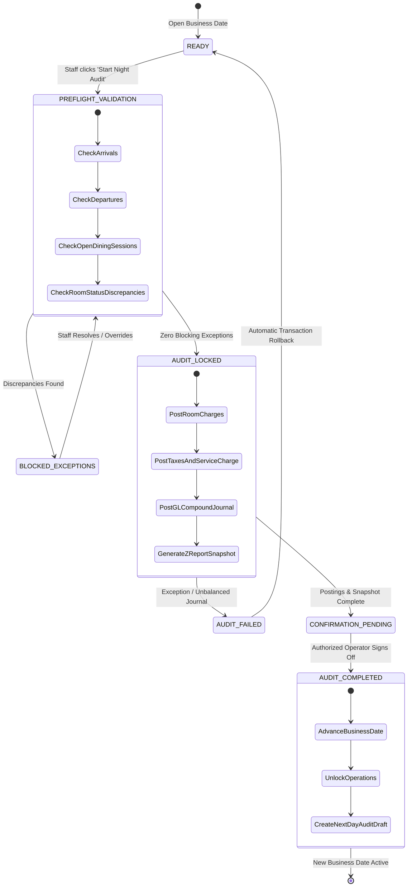

# Acrma Hotel ERP — Batch 3A: Night Audit Readiness Audit and Implementation Specification

**Document Version:** 1.0.0  
**Audit Date:** 2026-10-19  
**Execution Context:** Development Branch (`development`)  
**Audit Scope:** Read-Only Codebase Audit & End-of-Day Architecture Specification  
**Deliverable Path:** `docs/AUDIT_NIGHT_AUDIT_READINESS.md`  

---

## 1. Executive Summary

A comprehensive architectural and functional audit of the Acrma Hotel ERP codebase was conducted to determine its readiness for performing an operational, accounting-grade **Night Audit (End-of-Day Closure)**.

### Verdict: NOT OPERATIONAL
The current system has **no functioning night audit or end-of-day rollover process**. While basic reporting snapshots (`X-Report`, `Z-Report`) and double-entry general ledger infrastructure exist, the core Hospitality Property Management System (PMS) night-audit controls are entirely missing or disconnected.

### Critical Deficiencies Discovered

1. **Absence of a System Business Date:**  
   The application maintains **no stored business date** (`current_business_date`). All reservations, folio charges, and revenue reports operate solely against server operating system wall-clock timestamps (`timezone.now().date()`). Night audit cannot advance a business date that does not exist.

2. **No Automated Daily Room Revenue or Tax Accrual:**  
   Nightly room rates, VAT (15%), and Service Charges (10%) are **never posted to guest folios on a per-night basis**. Instead, the system relies on an upfront or lump-sum calculation at checkout (`base_price * nights`), which violates standard lodging accounting principles (USALI) and distorts daily financial reporting for multi-night stays.

3. **Front-Desk UI is a Static, Non-Functional Placeholder:**  
   The "Night Audit Snapshot" card in `hotel-frontend/src/RoomManager.js` (lines 738–750) merely displays four read-only counts (confirmed arrivals, in-house guests, cleaning queue, online bookings). It provides no button, modal, or endpoint to trigger an audit, review pre-flight checklists, or handle exceptions.

4. **Accidental Premature Day Closure in Reports Center:**  
   In `hotel-frontend/src/pages/ReportsCenter.js` (lines 51–53), merely clicking or navigating to the `zreport` tab immediately fires an unvalidated `POST /api/users/reports/z-report/` that updates `DayAuditLog.is_closed = True`. There is no confirmation dialog, exception gating, or idempotency safeguard.

5. **Z-Report Endpoint Does Not Close the Day Operatively:**  
   `ZReportView.post` (`apps/reporting/views.py:98-164`) computes a reporting snapshot of orders and `RoomHistory` rows. It does not advance dates, does not lock folios or tables, does not post general ledger journal entries, and can be invoked repeatedly, silently overwriting `DayAuditLog` without validation.

6. **Severe Double- and Triple-Counting in Daily Revenue Reports:**  
   `DailyRevenueReportView` (`apps/reporting/views.py:251-271`) calculates total revenue by adding `RoomHistory.revenue` + `Order.total_amount` + `FolioCharge.amount`. When a guest charges a restaurant meal to their room, that single charge is counted up to **three separate times** across F&B, Folio, and checkout room history.

7. **Missing Reservation Exception States:**  
   `Reservation.STATUS_CHOICES` (`hotel/models.py:170-179`) lacks a `no_show` status. Stale confirmed reservations cannot be systematically converted to no-shows or billed cancellation fees during night audit.

---

## 2. Existing Implementation Inventory

Below is an exhaustive inventory of all files, models, views, serializers, services, and UI components currently touching end-of-day operations, folios, room revenue, and reporting.

```
┌──────────────────────────────────────────────────────────────────────────────────┐
│                             EXISTING INVENTORY MAP                               │
├────────────────────────────┬─────────────────────────────────────────────────────┤
│ Frontend Components        │ • hotel-frontend/src/RoomManager.js:738-750         │
│                            │ • hotel-frontend/src/pages/ReportsCenter.js:51-53   │
├────────────────────────────┼─────────────────────────────────────────────────────┤
│ Core Data Models           │ • hotel/models.py: DayAuditLog (720-742)            │
│                            │ • hotel/models.py: Reservation (170-255)            │
│                            │ • hotel/models.py: Room (77-140)                    │
│                            │ • hotel/models.py: FolioCharge (697-716)            │
│                            │ • hotel/models.py: RoomHistory (626-655)            │
│                            │ • hotel/models.py: JournalEntry, Item (974-1040)    │
│                            │ • hotel/models.py: Account (915-970)                │
│                            │ • hotel/models.py: SystemSettings (549-585)         │
│                            │ • hotel/models.py: AuditEvent (1250-1310)           │
├────────────────────────────┼─────────────────────────────────────────────────────┤
│ Backend API Endpoints      │ • apps/reporting/views.py: ZReportView (97-164)     │
│                            │ • apps/reporting/views.py: XReportView (45-94)      │
│                            │ • apps/reporting/views.py: DailyRevenue (240-350)   │
│                            │ • apps/reporting/views.py: TaxReportView (380-474)  │
│                            │ • apps/reservations/views.py: Checkout (905-1015)   │
│                            │ • apps/reservations/views.py: FinalBill (709-746)   │
│                            │ • apps/reservations/views.py: CheckIn (748-903)     │
│                            │ • apps/reservations/views.py: FolioCharge (601-655) │
│                            │ • apps/audit/views.py: AuditEventListView (6-23)    │
├────────────────────────────┼─────────────────────────────────────────────────────┤
│ Services & Ledgers         │ • apps/orders/services.py: settle_order_payment     │
│                            │ • apps/finance/services.py: post_journal_entry      │
│                            │ • hotel/accounting.py: post_entry, reverse_entry    │
│                            │ • apps/audit/services.py: record_audit_event        │
├────────────────────────────┼─────────────────────────────────────────────────────┤
│ Existing Automated Tests   │ • apps/reporting/tests/test_report_permissions.py   │
│                            │   (Role checks only; zero business audit tests)     │
└────────────────────────────┴─────────────────────────────────────────────────────┘
```

### Detailed Component Analysis

### A. Frontend Components
- **`hotel-frontend/src/RoomManager.js` (lines 41–45, 189, 738–750):**  
  Renders the front-office view. When `activeSubNav === 'night-audit'`, it renders an informational container `auditBoard` with four counters: Confirmed arrivals, In-house guests, Cleaning queue, and Booked online.  
  *Finding:* Completely passive display. No button exists to initiate the audit, no form to select or confirm the business date, and no status feedback.
- **`hotel-frontend/src/pages/ReportsCenter.js` (lines 51–53):**  
  In `fetchReport()`, activating `activeTab === 'zreport'` issues `await axios.post(`${API_BASE_URL}/users/reports/z-report/`, { date: reportDate })` and sets `setZClosed(true)`.  
  *Finding:* A serious UX flaw: viewing the report automatically triggers the mutation endpoint that closes the day.

### B. Core Data Models
- **`hotel.models.DayAuditLog` (`hotel/models.py:720-742`):**  
  Fields: `audit_date` (DateField, unique), `is_closed` (bool), `closed_at` (datetime), `closed_by` (str), `total_cash`, `total_chapa`, `total_telebirr`, `total_card`, `total_room_revenue`, `total_revenue`, `notes`. Index: `audit_date_closed_idx`.  
  *Finding:* Lacks tracking for: business date advancement, starting cash, room nights posted, taxes, GL journal reference, error logs, and approval signatures.
- **`hotel.models.Reservation` (`hotel/models.py:170-255`):**  
  Fields: `status` (`pending`, `confirmed`, `checked_in`, `checked_out`, `cancelled`), `room`, `check_in_date`, `check_out_date`, `total_amount`, `deposit_amount`, etc.  
  *Finding:* `save()` enforces strict transitions (lines 236–244). It has **no `no_show` status**. If a confirmed guest does not arrive, front-desk staff can only cancel or leave them confirmed indefinitely.
- **`hotel.models.Room` (`hotel/models.py:77-140`):**  
  Contains `base_price`, `weekend_price`, `holiday_price`, `discount_percent`, `extra_bed_price`.  
  *Finding:* Code inspection reveals that `weekend_price`, `holiday_price`, `discount_percent`, and `extra_bed_price` are completely unused placeholders across all billing and reservation services. Billing calculates strictly `nights * room.base_price`.
- **`hotel.models.FolioCharge` (`hotel/models.py:697-716`):**  
  Fields: `reservation` (FK), `description` (char), `amount` (decimal), `added_by` (str), `added_at` (auto_now_add), `inventory_item` (FK null), `quantity` (decimal).  
  *Finding:* `FolioCharge` has no `business_date`, no `charge_type` (e.g. `room_rate`, `tax`, `service_charge`, `pos_order`), and no unique constraint on `(reservation, business_date, charge_type)`. Without this, re-running audit logic would duplicate charges.
- **`hotel.models.SystemSettings` (`hotel/models.py:549-585`):**  
  Fields: `hotel_name`, `tin_number`, tax toggles (`vat_enabled`, `vat_percentage=15.00`, `service_charge_enabled`, `service_charge_percentage=10.00`), POS settings.  
  *Finding:* Does **not** contain `current_business_date`, `audit_in_progress`, or `last_audit_run_at`.

### C. Backend Endpoints & Services
- **`apps.reporting.views.ZReportView` (`apps/reporting/views.py:97-164`):**  
  Endpoint: `POST /api/users/reports/z-report/`. Accepts `{ "date": "YYYY-MM-DD" }`. Aggregates paid orders for that calendar date and `RoomHistory` records with `event_type__in=["checkin", "checkout"]`. Sets `DayAuditLog.is_closed = True` and writes revenue sums.  
  *Finding:* It does not lock records, does not advance any date, does not verify unclosed orders or unassigned rooms, does not post daily room charges, and does not post a General Ledger journal entry.
- **`apps.reservations.views.EnhancedCheckoutView` (`apps/reservations/views.py:905-1015`):**  
  At checkout, calculates:
  `room_total = to_decimal(room.base_price) * nights`
  `extras_total = sum(to_decimal(c.amount) for c in folio_charges)`
  `grand_total = room_total + extras_total`  
  It then posts a lump-sum General Ledger journal entry crediting `4000` (Room Revenue) for the full stay.  
  *Finding:* Because room revenue is only recognized at checkout (or checkin), daily revenue reporting during a guest's stay is completely zero for accommodation.
- **`apps.orders.services.settle_order_payment` (`apps/orders/services.py:225-285`):**  
  When an F&B order is settled with payment method `Room Charge`, it creates a `FolioCharge` on the active reservation and posts a GL entry: Debit `1200` (Accounts Receivable / Guest Folio), Credit `4100` (F&B Revenue).  
  *Finding:* Handled cleanly in the General Ledger, but duplicated in reporting views (see Section 3).
- **`hotel.accounting.post_entry` (`hotel/accounting.py:20-70`):**  
  Provides atomic, balanced double-entry GL journal posting with `select_for_update()` on affected accounts.  
  *Finding:* A rock-solid accounting primitive ready to be used by the night audit engine.

---

## 3. Implemented, Partial, Placeholder, and Missing Functionality Matrix

| End-of-Day Capability | Implementation Status | Exact Code Reference | Architectural & Operational Deficiency |
| :--- | :--- | :--- | :--- |
| **Business Date Representation** | **MISSING** | `hotel/models.py:549` | No `business_date` field exists anywhere in the database. All operations assume server system wall-clock date (`timezone.now().date()`). |
| **Night Audit Front-Desk UI** | **PLACEHOLDER** | `hotel-frontend/src/RoomManager.js:738-750` | Displays 4 read-only stat counters. No initiation trigger, checklist, date display, or confirmation dialog. |
| **Operational Pre-Flight Checks** | **MISSING** | None | No validation exists for unassigned arrivals, pending departures, rooms in maintenance, or unbilled orders. |
| **Room Rate Plan Calculation** | **PARTIAL** | `hotel/models.py:104-108`, `apps/reservations/services.py:30-42` | Only `base_price` is utilized (`nights * base_price`). Fields `weekend_price`, `holiday_price`, and `discount_percent` are unused placeholders. |
| **Daily Room Charge Folio Posting** | **MISSING** | None | Room rates are never posted per night to `FolioCharge`. Accommodation is billed as a lump-sum at checkout or check-in. |
| **Hospitality Tax / SC Folio Posting** | **MISSING** | `apps/orders/services.py:43-65` | Taxes and service charges are calculated on F&B orders, but daily room accommodation tax is never computed or posted per room night. |
| **Restaurant-to-Room Folio Sync** | **IMPLEMENTED** | `apps/orders/services.py:229-250` | F&B orders paid via `Room Charge` post to `FolioCharge` and debit GL account `1200` (AR). |
| **Daily Reporting Revenue Integrity** | **PARTIAL / DEFECTIVE** | `apps/reporting/views.py:251-271` | Folio extras and restaurant room charges are counted twice or three times in `DailyRevenueReportView`. |
| **Z-Report Daily Financial Snapshot** | **PARTIAL** | `apps/reporting/views.py:97-164` | Generates summary of orders and `RoomHistory` rows, but does not advance business date, does not lock data, and can be rerun indefinitely. |
| **GL Journal Posting on Audit** | **MISSING** | None | Night audit creates no General Ledger entry (Debit `1200` Guest Ledger, Credit `4000` Room Revenue, Credit `2200` VAT Payable). |
| **Idempotency & Re-run Protection** | **MISSING** | `apps/reporting/views.py:125-135` | `DayAuditLog` is retrieved via `get_or_create()` and overwritten on each request without checking if the day was already closed. |
| **No-Show Processing** | **MISSING** | `hotel/models.py:170-179` | `Reservation` status choices do not include `no_show`. Unchecked-in confirmed reservations remain open indefinitely. |
| **Audit Trail & Attribution** | **PARTIAL** | `hotel/models.py:724`, `apps/audit/services.py:27` | `DayAuditLog.closed_by` records a single username string. Security `AuditEvent` exists in `apps/audit/` but is not hooked into day closure. |
| **Audit Rollback / Reopening** | **MISSING** | None | No mechanism exists to reverse a closed day, back out posted room charges, or reopen an audit. |

---

## 4. Proposed Business Workflow and State Transitions

To achieve operational and financial integrity, the end-of-day process must follow an 8-stage state machine that guarantees room charges are posted exactly once, exceptions are resolved prior to posting, and the business date advances only upon complete success.

### Audit Run State Machine



### Step-by-Step Workflow Specification

1. **Pre-Audit Health Check (Diagnostic / Pre-flight Phase):**
   - System retrieves `SystemSettings.current_business_date`.
   - Validates that previous date is `COMPLETED` and today is not already closed.
   - Collects operational exceptions without modifying data:
     - **Unprocessed Arrivals:** Reservations where `status == "confirmed"` and `check_in_date <= current_business_date`.
     - **Pending Departures:** Reservations where `status == "checked_in"` and `check_out_date <= current_business_date`.
     - **Open Restaurant Tables:** `DiningSession` where `status == "active"`.
     - **Unpaid Open Orders:** `Order` where `status != "paid"` or `payment_status != "paid"`.
     - **Rate Discrepancies:** In-house reservations with zero or negative room rate.
     - **Room Status Conflicts:** Rooms flagged `Maintenance` or `Cleaning` with an active `checked_in` reservation.

2. **Exception Resolution (Operator Intervention):**
   - The UI presents an actionable modal:
     - Confirmed arrivals must be checked in, cancelled, or marked **No-Show** (with optional 1-night billing).
     - Overdue departures must be extended (new check-out date) or checked out via `EnhancedCheckoutView`.
     - Open dining sessions must be settled by the cashier or transferred to a guest folio.
   - Audit cannot proceed until all blocking exceptions are cleared or explicitly overridden with admin credentials.

3. **System Lock & Concurrency Boundary:**
   - System acquires a database lock on `SystemSettings` singleton (`select_for_update()`).
   - Sets `audit_in_progress = True`.
   - New check-ins, check-outs, and restaurant orders for the closing business date are temporarily rejected with HTTP 423 (Locked): *"Night audit in progress for date YYYY-MM-DD"*.

4. **Room Night & Tax Posting Engine:**
   - System queries all eligible reservations:
     `Reservation.objects.filter(status="checked_in", check_in_date__lte=business_date, check_out_date__gt=business_date)`
   - For each eligible reservation:
     - Calculates effective daily room rate (using booked rate from reservation or rate schedule).
     - Calculates room VAT (15%) and Service Charge (10%) based on system settings.
     - Creates atomic `FolioCharge` records:
       - `charge_type = 'room_night'`, `amount = daily_room_rate`, `business_date = current_business_date`, `is_audit_posted = True`
       - `charge_type = 'vat'`, `amount = daily_vat_amount`, `business_date = current_business_date`, `is_audit_posted = True`
       - `charge_type = 'service_charge'`, `amount = daily_sc_amount`, `business_date = current_business_date`, `is_audit_posted = True`
     - Database enforces unique constraint: `[reservation, business_date, charge_type='room_night']`. Duplicate charges are physically impossible.

5. **General Ledger Journal Entry Posting:**
   - Night audit calls `hotel.accounting.post_entry()` with a compound journal entry:
     - **Debit:** Account `1200` (Guest Ledger / Accounts Receivable) = `Total Room Revenue + Total Room VAT + Total Room SC`
     - **Credit:** Account `4000` (Room Revenue) = `Total Net Room Revenue`
     - **Credit:** Account `2200` (VAT Payable) = `Total Room VAT`
     - **Credit:** Account `2300` (Service Charge Payable) = `Total Room Service Charge`
   - Atomically updates account balances and links `journal_entry_id` to the audit session.

6. **Z-Report Snapshot Generation:**
   - Computes daily reconciliation metrics:
     - Total Room Revenue (posted room nights)
     - Total F&B Revenue (cash, card, digital, room charge)
     - Total Folio Extras (minibar, laundry)
     - Total Payments Collected (broken down by Cash, Telebirr, Chapa, Card, Bank)
     - Total Outstanding Guest Ledger Balance
   - Saves immutable snapshot record in `NightAuditSession` / `DayAuditLog`.

7. **Operator Confirmation & Sign-Off:**
   - Operator reviews the summary reconciliation figures on screen.
   - Enters mandatory shift closing notes and clicks **"Confirm & Finalize Night Audit"**.

8. **Business Date Advancement & Release:**
   - Updates `SystemSettings.current_business_date = current_business_date + timedelta(days=1)`.
   - Sets `audit_in_progress = False`.
   - Records `AuditEvent` (Action: `NIGHT_AUDIT_COMPLETED`, Actor: Operator, Metadata: financial summary).
   - Unlocks front-desk and POS operations for the new business day.

---

## 5. Data Model and API Changes Required

### A. Data Model Enhancements

#### 1. Enhance `SystemSettings` (`hotel/models.py`)
Add fields:
```python
current_business_date = models.DateField(default=timezone.now, help_text="Active PMS business date")
audit_in_progress = models.BooleanField(default=False, help_text="True while night audit is running")
last_audit_completed_at = models.DateTimeField(null=True, blank=True)
last_audit_operator = models.CharField(max_length=150, blank=True)
```

#### 2. Enhance `FolioCharge` (`hotel/models.py`)
Add fields and constraints:
```python
CHARGE_TYPE_CHOICES = [
    ("room_night", "Room Night Charge"),
    ("vat", "VAT (Room)"),
    ("service_charge", "Service Charge (Room)"),
    ("fb_order", "Food & Beverage Order"),
    ("minibar", "Minibar"),
    ("laundry", "Laundry"),
    ("misc", "Miscellaneous Extra"),
]
charge_type = models.CharField(max_length=30, choices=CHARGE_TYPE_CHOICES, default="misc")
business_date = models.DateField(null=True, blank=True, db_index=True)
is_audit_posted = models.BooleanField(default=False)
audit_log = models.ForeignKey("DayAuditLog", null=True, blank=True, on_delete=models.PROTECT, related_name="posted_charges")

class Meta:
    # Existing ordering and indexes preserved...
    constraints = [
        models.UniqueConstraint(
            fields=["reservation", "business_date"],
            condition=models.Q(charge_type="room_night"),
            name="unique_daily_room_charge_per_reservation",
        )
    ]
```

#### 3. Enhance `Reservation` (`hotel/models.py`)
Add `no_show` status and preserve booked rate:
```python
STATUS_CHOICES = [
    ("pending", "Pending"),
    ("confirmed", "Confirmed"),
    ("checked_in", "Checked In"),
    ("checked_out", "Checked Out"),
    ("no_show", "No Show"),      # ← Added
    ("cancelled", "Cancelled"),
]
# Update allowed transitions in save():
# "confirmed": {"checked_in", "cancelled", "no_show"}
```

#### 4. Upgrade `DayAuditLog` (`hotel/models.py`)
Transform `DayAuditLog` from a loose reporting table to an auditable session log:
```python
STATUS_CHOICES = [
    ("in_progress", "In Progress"),
    ("completed", "Completed"),
    ("failed", "Failed"),
    ("reopened", "Reopened"),
]
status = models.CharField(max_length=20, choices=STATUS_CHOICES, default="in_progress")
started_at = models.DateTimeField(auto_now_add=True)
idempotency_key = models.CharField(max_length=64, unique=True, null=True, blank=True)
gl_entry = models.ForeignKey("JournalEntry", null=True, blank=True, on_delete=models.PROTECT, related_name="audit_logs")
exceptions_snapshot = models.JSONField(default=dict, blank=True)
total_vat = models.DecimalField(max_digits=12, decimal_places=2, default=0)
total_service_charge = models.DecimalField(max_digits=12, decimal_places=2, default=0)
room_nights_posted = models.IntegerField(default=0)
```

---

### B. Proposed API Endpoints

| Method | Endpoint | Description | Role Required |
| :--- | :--- | :--- | :--- |
| `GET` | `/api/night-audit/status/` | Returns active business date, lock state, and last audit metadata | Reception, Finance, Admin |
| `GET` | `/api/night-audit/preflight/` | Runs non-mutating pre-flight diagnostic; returns blocking exceptions | Reception, Finance, Admin |
| `POST` | `/api/night-audit/resolve-exception/` | Handles specific exceptions (e.g., mark arrival as no-show) | Reception, Admin |
| `POST` | `/api/night-audit/run/` | Executes atomic audit, posts room charges, GL journal, rolls date | Admin, Finance, Reception |
| `GET` | `/api/night-audit/history/` | Lists historical closed audits and Z-reports by business date | Finance, Admin, Reception |
| `POST` | `/api/night-audit/reopen/` | Reopens a closed audit (Admin only; requires written justification & GL reversal) | Admin Superuser Only |

---

## 6. Transaction, Idempotency, Concurrency, and Recovery Design

### Failure Mode Risk Analysis

| Failure Scenario | Immediate Risk | Root Cause in Existing Code | Architectural Mitigation Design |
| :--- | :--- | :--- | :--- |
| **Server crash halfway through room charge posting** | Partial folios charged, remaining guests uncharged, GL out of sync. | Lack of single enclosing transaction boundary across the loop. | Wrap all folio postings and GL creation in `with transaction.atomic():`. If process terminates, database rolls back cleanly. |
| **Room charges succeed, but audit log fails to save** | Charges posted to folios, but business date does not advance. | Decoupled operations in different views. | Single atomic transaction; date advance occurs in the exact same commit block as room charges and `DayAuditLog`. |
| **Repeated request / Operator double-click** | Duplicate room charges on guest folios; double-counted revenue. | `ZReportView` and `FolioCharge` lack idempotency keys and unique DB constraints. | 1. Client sends unique `Idempotency-Key` header.<br>2. DB unique constraint `(reservation, business_date, 'room_night')` rejects duplicates with `IntegrityError`. |
| **Concurrent audit requests from two terminals** | Race condition; both threads query eligible rooms and attempt double post. | No row-level locking on settings. | `SystemSettings.objects.select_for_update()` at the start of the audit endpoint. Second request waits or fails immediately with HTTP 409 Conflict. |
| **Checked-out reservation with unpaid folio balance** | Revenue lost or uncollected; guest departs with open balance. | Front desk checks out without validating `extras_total <= payments`. | Pre-flight check blocks night audit if any check-out from today has an unpaid balance without credit approval. |
| **In-house guest with zero or missing room rate** | Missing revenue or division-by-zero error during audit. | Rates dynamically read from `Room.base_price` which may be altered to 0. | Pre-flight check flags room as "Zero Rate Exception". Operator must confirm complimentary status or set rate before proceeding. |
| **Room under Maintenance / Cleaning with in-house guest** | Physical room occupied while system lists it as out-of-order. | Front desk status changes do not validate active reservation presence. | Pre-flight check flags status discrepancy; staff confirms room occupancy before posting room night. |
| **Restaurant charge posted during audit execution** | Folio charged while audit is computing closing reconciliation. | POS orders touch folios asynchronously with no lock check. | `audit_in_progress = True` prevents POS room charges during the brief (1–2 second) posting transaction. |
| **Attempted audit for an already closed business date** | Overwriting historical Z-report data. | `ZReportView` performs `get_or_create(audit_date=...)` without checking `is_closed`. | Endpoint checks `DayAuditLog.objects.filter(audit_date=target_date, is_closed=True).exists()`. Rejects with HTTP 400: *"Date already closed"*. |

---

## 7. Authorization and Operational Controls

### Role Matrix

| Action | Reception | Finance | Admin / Superuser | Waiter / Cashier / Kitchen / Housekeeping |
| :--- | :---: | :---: | :---: | :---: |
| **View Night Audit Dashboard & Status** | Yes | Yes | Yes | Denied (403) |
| **Run Diagnostic Pre-Flight Check** | Yes | Yes | Yes | Denied (403) |
| **Resolve Operational Exceptions (No-show, Extend)** | Yes | Denied | Yes | Denied (403) |
| **Initiate & Execute Night Audit** | Designated Night Auditor | Yes | Yes | Denied (403) |
| **Override Blocking Operational Exception** | Denied | Denied | Yes (Admin Override) | Denied (403) |
| **Reopen / Roll Back Closed Business Date** | Denied | Denied | Superuser Only | Denied (403) |

### Audit Logging & Least Privilege
- Every execution of `/api/night-audit/run/` records a persistent `AuditEvent` (`hotel.models.AuditEvent`) via `apps.audit.services.record_audit_event()`.
- The event records: `actor_id`, `actor_role`, `source_ip`, `request_id`, `client_metadata`, and a JSON diff of the before-and-after business date and summary balances.
- If an admin overrides a pre-flight warning (e.g. allowing an open table session to remain open overnight), an explicit `reason` string must be supplied and saved in the audit event.

---

## 8. Regression Test Plan

Before implementing Batch 3B, a comprehensive test suite must be designed to validate existing features alongside the new audit controls.

```
┌──────────────────────────────────────────────────────────────────────────────────┐
│                             REGRESSION TEST SUITE                                │
├──────────────────────────────────────────────────────────────────────────────────┤
│ 1. Room-Night Calculation & Posting Tests                                        │
│    • In-house guest gets exactly 1 room charge for the business date.            │
│    • Stays spanning multiple nights accrue 1 charge per date audit execution.    │
│    • Checked-out guests are not charged for subsequent nights.                   │
│    • Reservations arriving in the future are not charged.                       │
│                                                                                  │
│ 2. Idempotency & Duplicate Prevention Tests                                      │
│    • Executing audit twice for the same date does not post duplicate charges.    │
│    • Attempting to run audit while already in progress returns HTTP 409.         │
│    • Database UniqueConstraint rejects duplicate room-night charge.              │
│                                                                                  │
│ 3. Atomic Transaction Rollback Tests                                             │
│    • Forced exception in GL journal posting triggers full rollback of folios.    │
│    • Database remains in pre-audit state if any step fails.                      │
│                                                                                  │
│ 4. Exception Gating Tests                                                        │
│    • Confirmed arrival from yesterday blocks audit completion.                   │
│    • Active dining session on restaurant table blocks audit until closed/waived. │
│    • Admin override successfully permits audit with justification logged.        │
│                                                                                  │
│ 5. Financial & Folio Reconciliation Tests                                        │
│    • Folio balance equals deposit + payments - (room nights + extras).           │
│    • Restaurant room charges appear on folio without duplicating GL AR.          │
│    • Daily revenue report does not double count room charges and folio extras.   │
│                                                                                  │
│ 6. Authorization & Role Access Tests                                             │
│    • Waiter, Kitchen, Bar, Cashier, and Housekeeping roles receive HTTP 403.     │
│    • Reception and Finance can execute audit.                                    │
│    • Only Superuser can access reopen endpoint.                                  │
│                                                                                  │
│ 7. Existing Module Non-Regression Verification                                    │
│    • Cashier dining session billing and receipt printing unaffected.             │
│    • Digital check-in and enhanced checkout continue working seamlessly.         │
│    • Housekeeping task auto-generation on checkout remains operational.          │
└──────────────────────────────────────────────────────────────────────────────────┘
```

---

## 9. Migration and Deployment Risks

### Database Engine Discrepancies (PostgreSQL vs. SQLite)
- **Production Environment:** Neon.tech PostgreSQL (SSL required, connection pooler PgBouncer).
- **PgBouncer Pooling Risk:** Neon transaction-mode connection poolers (`-pooler` in `DATABASE_URL`) reject session-level locks and session parameters (e.g. `SET statement_timeout`). Row-level locks (`select_for_update()`) **must** be executed strictly within an explicit Django transaction block (`transaction.atomic()`). Outside a transaction block, `select_for_update()` will fail on pooled PostgreSQL connections.
- **Migration Backward Compatibility:**
  Existing databases contain active reservations created under the legacy lump-sum model.
  - *Risk:* If a guest checked in 3 days ago under the old system, their folio currently has 0 room night charges.
  - *Mitigation:* The migration must initialize `SystemSettings.current_business_date = timezone.now().date()`. For active in-house reservations, the system should only post room charges starting from the date the night audit is turned on, or provide a one-time reconciliation utility to catch up historical in-house nights.

---

## 10. Explicit Business Decisions Requiring Stakeholder Approval

The following 7 business and accounting questions must be formally decided by hotel management prior to implementing Batch 3B:

1. **Room Rate Calculation Source of Truth:**  
   *Question:* Should the nightly room charge posted by the audit equal `Reservation.total_amount / nights` (the locked rate agreed at booking), or `Room.base_price` (the current live catalog rate)?  
   *Recommendation:* Use `Reservation.total_amount / nights` (or store explicit `daily_rate` on the reservation) so that manual discounts or seasonal rates negotiated at booking are preserved.

2. **Tax Inclusivity vs. Exclusivity:**  
   *Question:* Are room rates quoted to guests inclusive or exclusive of Ethiopian 15% VAT and 10% Service Charge?  
   *Current Code:* F&B orders treat subtotal as net and add 10% SC and 15% VAT on top. Room reservations treat `base_price` as the total gross price.  
   *Recommendation:* Clarify whether room rate posted to folio is gross (with tax extracted for GL) or net (with tax added as separate folio line items).

3. **No-Show Penalty Policy:**  
   *Question:* When a confirmed reservation is marked as "No Show" during night audit, should the system automatically charge a 1-night penalty against their deposit/card, or simply cancel the booking?  
   *Recommendation:* Provide the auditor a choice: "Bill 1 Night Retention" or "Waive & Cancel".

4. **Day-Use / Same-Day Checkout Handling:**  
   *Question:* If a guest checks in at 10:00 AM and checks out at 4:00 PM on the same date, night audit has not yet run. How should room revenue be accrued?  
   *Recommendation:* `EnhancedCheckoutView` should post the room night charge immediately upon checkout *only if* no room night charge has been posted for that reservation yet.

5. **Open Restaurant Tables at Midnight:**  
   *Question:* Can night audit proceed if the hotel bar or restaurant still has active dining sessions at 02:00 AM?  
   *Recommendation:* Night audit should allow an "Open Dining Session Exception" where F&B shifts roll over independently or remain open, but any orders charged to a room must be posted to that guest's folio before that room's night audit finalizes.

6. **Cut-off Time and Automation:**  
   *Question:* Should night audit be strictly manual (triggered by the night receptionist after verifying the house), or automated via a scheduled cron job (e.g. 04:00 AM)?  
   *Recommendation:* Manual trigger with UI checklist is standard for boutique and independent hotels to prevent premature automated closing while guests are still arriving.

7. **Audit Reopening Policy:**  
   *Question:* If an audit is run with errors, is the hotel permitted to reopen a closed business date?  
   *Recommendation:* Direct reopening should be prohibited. Corrections should follow standard hospitality accounting by posting adjustment vouchers (credit/debit memos) on the current active business date.

---

## 11. Recommended Implementation Batches & Acceptance Criteria

To ensure safety, zero regression, and manageable verification steps, implementation should proceed in four small, focused batches:

```
┌──────────────────────────────────────────────────────────────────────────────────┐
│                           PROPOSED IMPLEMENTATION ROADMAP                        │
├─────────────────┬──────────────────────────────────┬─────────────────────────────┤
│ Batch 3B        │ Business Date & Audit Foundation │ • SystemSettings fields     │
│                 │                                  │ • DayAuditLog model upgrade │
│                 │                                  │ • Status & Preflight APIs   │
├─────────────────┼──────────────────────────────────┼─────────────────────────────┤
│ Batch 3C        │ Room Posting & Folio Integrity   │ • FolioCharge constraints   │
│                 │                                  │ • NightAuditPostingService  │
│                 │                                  │ • Atomic GL journal post    │
├─────────────────┼──────────────────────────────────┼─────────────────────────────┤
│ Batch 3D        │ Front-Office Night Audit UI      │ • Interactive React modal   │
│                 │                                  │ • Pre-flight checklist      │
│                 │                                  │ • Exception resolution flows│
├─────────────────┼──────────────────────────────────┼─────────────────────────────┤
│ Batch 3E        │ Revenue Reporting Alignment      │ • Fix double counting       │
│                 │ & End-to-End Hardening           │ • Full regression suite     │
└─────────────────┴──────────────────────────────────┴─────────────────────────────┘
```

### Batch 3B: Business Date & Audit Foundation
- **Scope:** Add `current_business_date` and `audit_in_progress` to `SystemSettings`. Add `no_show` to `Reservation`. Create `NightAuditPreflightService` and `GET /api/night-audit/status/`, `GET /api/night-audit/preflight/`.
- **Acceptance Criteria:**
  - System returns active business date.
  - Pre-flight diagnostic accurately flags pending arrivals, pending departures, and open tables without altering DB records.

### Batch 3C: Room Posting Engine & Folio Integrity
- **Scope:** Add `charge_type`, `business_date`, and unique constraint to `FolioCharge`. Implement `NightAuditService.run_audit()`.
- **Acceptance Criteria:**
  - Running audit posts exactly 1 room charge and tax line per active in-house reservation.
  - Re-executing audit raises an exception and posts 0 duplicate charges.
  - General Ledger creates a balanced compound journal entry (Debit AR, Credit Room Revenue, Credit VAT).
  - Business date advances by exactly 1 day.

### Batch 3D: Front-Desk UI Audit Center
- **Scope:** Replace static placeholder card in `RoomManager.js` with an interactive "Night Audit Control Center". Add pre-flight verification checklist, exception resolution modals, and final confirmation dialog. Remove auto-POST trigger from `ReportsCenter.js:51-53`.
- **Acceptance Criteria:**
  - Auditor can view pre-flight status, resolve arrivals/departures, and execute the audit with explicit confirmation.
  - Navigating to Z-report tab in Reports Center no longer mutates database state.

### Batch 3E: Reporting Alignment & End-to-End Hardening
- **Scope:** Correct `DailyRevenueReportView` to prevent double-counting of room charges and restaurant folios. Write full automated regression test suite.
- **Acceptance Criteria:**
  - `DailyRevenueReportView` total revenue matches sum of audited Z-reports and GL ledger.
  - 100% of automated tests pass (including existing 196 tests).

---

## 12. Verification & Safety Confirmation

In compliance with the safety rules for Batch 3A:
- **Git Branch:** Verified on `development`.
- **Working Tree Integrity:** All uncommitted changes from Batches 1A, 1B, 1B.1, 1B.2, and Batch 2 were strictly preserved. Zero files were staged, committed, reset, or discarded.
- **Database Safety:** Zero migrations were created or applied. No database records were modified or deleted.
- **Read-Only Compliance:** No application code was altered. Only this report (`docs/AUDIT_NIGHT_AUDIT_READINESS.md`) was authored.
- **Next Step:** Halt and await stakeholder review and approval before proceeding to Batch 3B.
