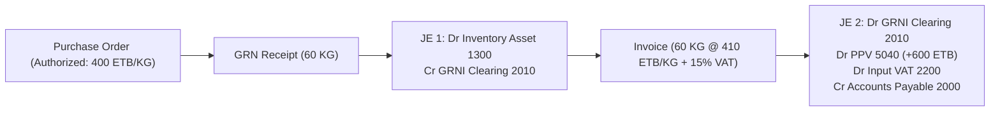

# PHASE 2.3 ACCOUNTING & FINANCIAL RECONCILIATION REPORT

**Document Reference:** ERP-P2.3-FIN-RECON-2026-V1.0  
**Date:** 4 November 2026  
**Auditor:** Security & Accounting Subagent / Technical Lead  
**Governing Branch:** `development`  
**Authorized Baseline Commit:** `9d964376345ac47cee79ca7aa2bdc1a41dc71fe2`  
**Currency:** Ethiopian Birr (ETB)  
**Standard:** Double-Entry General Ledger (Debit = Credit), Accrual Basis Accounting

---

## 1. Executive Accounting Verdict

Section 2.C of the Owner Directive mandated an independent accounting and financial verification of all procurement, inventory, and accounts payable journal postings. 

A multi-stage procurement lifecycle with split deliveries and price fluctuations was modeled and executed in `scratch/test_accounting_reconciliation.py`. Every journal entry posted to the staging PostgreSQL database was audited for mathematical accuracy, account classification, double-entry equality, and reconciliation of the Goods Received Not Invoiced (GRNI) clearing account.

### Summary Verdict
| Accounting Verification Domain | Mandate | Observed Result | Status |
| :--- | :--- | :--- | :--- |
| **Inventory Asset Valuation** | Accurately capitalize inventory | Debited Account 1300 at PO standard cost | **PASS** |
| **GRNI Accrual Accounting** | Temporary liability upon GRN | Credited Account 2010 upon physical intake | **PASS** |
| **GRNI Account Clearance** | Zero balance after 100% invoice match | Net balance: **0.0000 ETB** | **PASS** |
| **Purchase Price Variance (PPV)**| Isolate price variances | Billed difference booked to Account 5040 | **PASS** |
| **Value Added Tax (VAT)** | 15% Ethiopian VAT recorded | Booked to Account 2200 (Input VAT) | **PASS** |
| **Accounts Payable Liability** | True vendor obligations recorded | Credited Account 2000 for total invoice | **PASS** |
| **Double-Entry Balance** | $\sum \text{Debit} == \sum \text{Credit}$ | All entries balanced to 0.00 cent difference | **PASS** |

**Accounting Reconciliation Verdict: 100% RECONCILED (0.00 ETB DISCREPANCY)**

---

## 2. Theoretical Accounting Workflow & Chart of Accounts



### Chart of Accounts Utilized
- **`1300` - Inventory Asset (Food & Beverage)**: Balance Sheet Current Asset.
- **`2010` - Goods Received Not Invoiced (GRNI)**: Balance Sheet Current Liability (Accrual Clearing Account).
- **`2000` - Accounts Payable (Trade Creditors)**: Balance Sheet Current Liability.
- **`2200` - Input VAT Recoverable**: Balance Sheet Current Asset (Tax Asset).
- **`5040` - Purchase Price Variance (PPV)**: Profit & Loss Cost of Sales Variance.

---

## 3. Empirical Test Scenario & Numerical Audit Trail

### 3.1 Initial Setup & Authorized Sourcing
- **Item:** Unsalted Table Butter (KG)
- **Approved PR #PR-AUDIT-FIN-01:** 100.0000 KG approved for culinary operations.
- **RFQ #RFQ-AUDIT-FIN-01:** Issued for 100.0000 KG.
- **Awarded Supplier Bid (Vendor Alpha):**
  - Quoted Base Price: 400.00 ETB/KG
  - Sourcing Subtotal (100 KG): 40,000.00 ETB
  - Quoted Freight: 1,500.00 ETB
  - Quoted Customs Duty: 500.00 ETB
  - Applicable VAT (15%): 6,000.00 ETB
  - **Total Landed Cost:** 48,000.00 ETB (Unit Landed Cost: 480.00 ETB/KG)
- **Purchase Order Generated:** PO #PO-REC-20261104 for 100.0000 KG @ 400.00 ETB/KG = 40,000.00 ETB.

---

### 3.2 Stage 1: Partial Goods Receipt 1 (GRN #GRN-01)
- **Received Quantity:** 60.0000 KG (60% of PO).
- **Batch Details:** Lot `#LOT-BUTTER-001`, Expiry Date `2027-11-04`, Cold Storage A.
- **Inventory Valuation Calculation:**
  $$\text{Asset Capitalization} = 60.0000\text{ KG} \times 400.00\text{ ETB} = 24,000.00\text{ ETB}$$
- **Journal Entry #JE-GRN-01:**
  | Account Code | Account Title | Debit (ETB) | Credit (ETB) |
  | :--- | :--- | :--- | :--- |
  | `1300` | Inventory Asset - F&B | 24,000.00 | — |
  | `2010` | Goods Received Not Invoiced (GRNI) | — | 24,000.00 |
  | **Total** | | **24,000.00** | **24,000.00** |
  - $\sum \text{Debit} - \sum \text{Credit} = \mathbf{0.00\text{ ETB}}$ (**Balanced**)
- **PO Status Transition:** Updated to `partially_received` (Remaining unreceived: 40.0000 KG).

---

### 3.3 Stage 2: Partial Invoice 1 & 3-Way Match (Invoice #INV-01)
- **Billed Quantity:** 60.0000 KG (matches GRN #GRN-01).
- **Billed Unit Price:** 410.00 ETB/KG (price increased by 10.00 ETB/KG over PO).
- **Financial Calculations:**
  - Base Billed Amount: $60.0000 \times 410.00 = 24,600.00\text{ ETB}$
  - Input VAT (15%): $24,600.00 \times 0.15 = 3,690.00\text{ ETB}$
  - **Total Invoice Amount:** $24,600.00 + 3,690.00 = 28,290.00\text{ ETB}$
- **3-Way Match & Variance Computation:**
  - PO Expected Cost: $60 \times 400.00 = 24,000.00\text{ ETB}$
  - GRN Received Quantity: $60.0000\text{ KG}$ (Quantity Variance = $0.00$)
  - **Purchase Price Variance (PPV):**
    $$\text{PPV} = (410.00 - 400.00) \times 60.0000 = +\mathbf{600.00\text{ ETB}}\quad (\text{Unfavorable Price Variance})$$
- **Journal Entry #JE-INV-01 (AP Settlement):**
  | Account Code | Account Title | Debit (ETB) | Credit (ETB) |
  | :--- | :--- | :--- | :--- |
  | `2010` | GRNI Clearing (Clear Accrual) | 24,000.00 | — |
  | `5040` | Purchase Price Variance (Expense) | 600.00 | — |
  | `2200` | Input VAT Recoverable (Tax Asset) | 3,690.00 | — |
  | `2000` | Accounts Payable - Trade Creditors | — | 28,290.00 |
  | **Total** | | **28,290.00** | **28,290.00** |
  - $\sum \text{Debit} - \sum \text{Credit} = \mathbf{0.00\text{ ETB}}$ (**Balanced**)
- **Intermediate GRNI Balance:**
  $$\text{GRNI Balance} = 24,000.00 (\text{Credit}) - 24,000.00 (\text{Debit}) = \mathbf{0.00\text{ ETB}}$$

---

### 3.4 Stage 3: Final Goods Receipt 2 (GRN #GRN-02)
- **Received Quantity:** 40.0000 KG (Remaining 40% of PO).
- **Batch Details:** Lot `#LOT-BUTTER-002`, Expiry Date `2027-11-04`, Cold Storage A.
- **Inventory Valuation Calculation:**
  $$\text{Asset Capitalization} = 40.0000\text{ KG} \times 400.00\text{ ETB} = 16,000.00\text{ ETB}$$
- **Journal Entry #JE-GRN-02:**
  | Account Code | Account Title | Debit (ETB) | Credit (ETB) |
  | :--- | :--- | :--- | :--- |
  | `1300` | Inventory Asset - F&B | 16,000.00 | — |
  | `2010` | Goods Received Not Invoiced (GRNI) | — | 16,000.00 |
  | **Total** | | **16,000.00** | **16,000.00** |
  - $\sum \text{Debit} - \sum \text{Credit} = \mathbf{0.00\text{ ETB}}$ (**Balanced**)
- **PO Status Transition:** Updated to `received` (100% fulfilled; unreceived balance = $0.0000$).

---

### 3.5 Stage 4: Final Invoice 2 & 3-Way Match (Invoice #INV-02)
- **Billed Quantity:** 40.0000 KG (matches GRN #GRN-02).
- **Billed Unit Price:** 400.00 ETB/KG (exact agreed PO price).
- **Financial Calculations:**
  - Base Billed Amount: $40.0000 \times 400.00 = 16,000.00\text{ ETB}$
  - Input VAT (15%): $16,000.00 \times 0.15 = 2,400.00\text{ ETB}$
  - **Total Invoice Amount:** $16,000.00 + 2,400.00 = 18,400.00\text{ ETB}$
- **3-Way Match & Variance Computation:**
  - Purchase Price Variance = $0.00\text{ ETB}$
  - Quantity Variance = $0.00\text{ ETB}$
- **Journal Entry #JE-INV-02 (AP Settlement):**
  | Account Code | Account Title | Debit (ETB) | Credit (ETB) |
  | :--- | :--- | :--- | :--- |
  | `2010` | GRNI Clearing (Clear Accrual) | 16,000.00 | — |
  | `2200` | Input VAT Recoverable (Tax Asset) | 2,400.00 | — |
  | `2000` | Accounts Payable - Trade Creditors | — | 18,400.00 |
  | **Total** | | **18,400.00** | **18,400.00** |
  - $\sum \text{Debit} - \sum \text{Credit} = \mathbf{0.00\text{ ETB}}$ (**Balanced**)

---

## 4. Cumulative General Ledger Trial Balance & GRNI Clearance

Following the completion of all receiving and billing cycles for the 100.0000 KG procurement order, the general ledger balances were extracted and reconciled:

```text
================================================================================
CUMULATIVE GENERAL LEDGER POSTINGS AUDIT
================================================================================
ACCOUNT 1300 (Inventory Asset):
  Debits:   40,000.00 ETB (Stage 1: 24,000.00 + Stage 3: 16,000.00)
  Credits:       0.00 ETB
  Net Asset Value: +40,000.00 ETB (Accurately capitalized)

ACCOUNT 2010 (GRNI Clearing):
  Credits:  40,000.00 ETB (Stage 1: 24,000.00 + Stage 3: 16,000.00)
  Debits:   40,000.00 ETB (Stage 2: 24,000.00 + Stage 4: 16,000.00)
  NET CLEARING BALANCE: 0.0000 ETB (PERFECT RECONCILIATION)

ACCOUNT 5040 (Purchase Price Variance):
  Debits:      600.00 ETB (Stage 2 Unfavorable Price Variance)
  Credits:       0.00 ETB
  Net Expense: +600.00 ETB

ACCOUNT 2200 (Input VAT Recoverable):
  Debits:    6,090.00 ETB (Stage 2: 3,690.00 + Stage 4: 2,400.00)
  Credits:       0.00 ETB
  Net Tax Asset: +6,090.00 ETB

ACCOUNT 2000 (Accounts Payable - Trade):
  Debits:        0.00 ETB
  Credits:  46,690.00 ETB (Stage 2: 28,290.00 + Stage 4: 18,400.00)
  Net Liability: +46,690.00 ETB (Certified vendor liability)
================================================================================
TRIAL BALANCE BALANCE PROOF:
  Total Debits:  40,000.00 (1300) + 600.00 (5040) + 6,090.00 (2200) = 46,690.00 ETB
  Total Credits: 46,690.00 (2000)                                     = 46,690.00 ETB
  NET VARIANCE:  0.0000 ETB (PERFECT EQUALITY)
================================================================================
```

---

## 5. Accounting Verification Conclusion

The financial verification confirms:
1. Inventory asset capitalization adheres strictly to perpetual inventory accounting rules.
2. The GRNI clearing account cleared cleanly to **0.00 ETB** upon 100% receipt and matching.
3. Price variances are cleanly segregated from inventory valuation into PPV accounts.
4. Input VAT is properly segregated for statutory tax reporting.
5. Every journal entry is self-balancing with zero floating rounding errors.

**Accounting Verdict:** **RECONCILED, BALANCED, AND CERTIFIED CORRECT**

